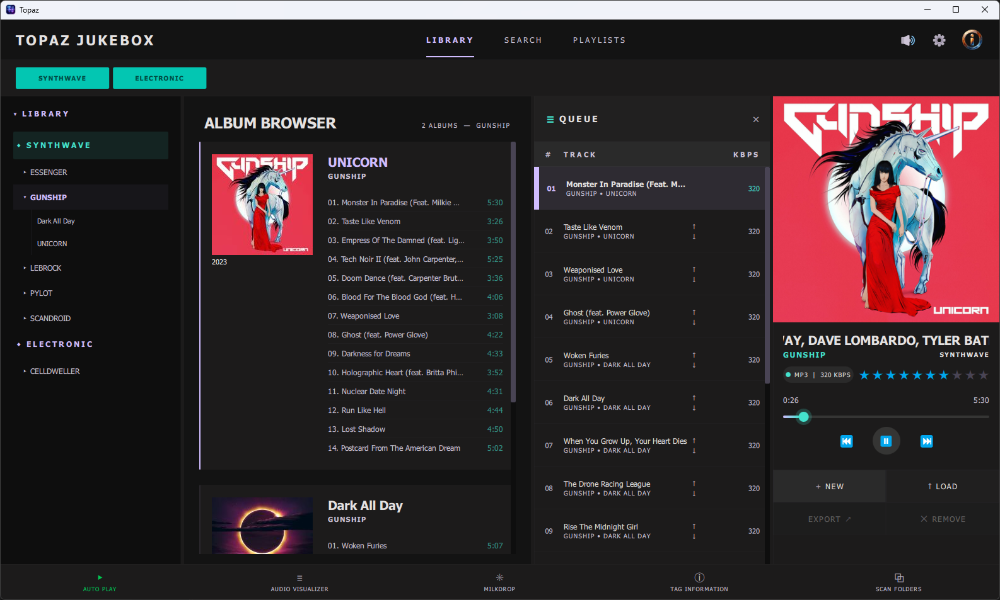
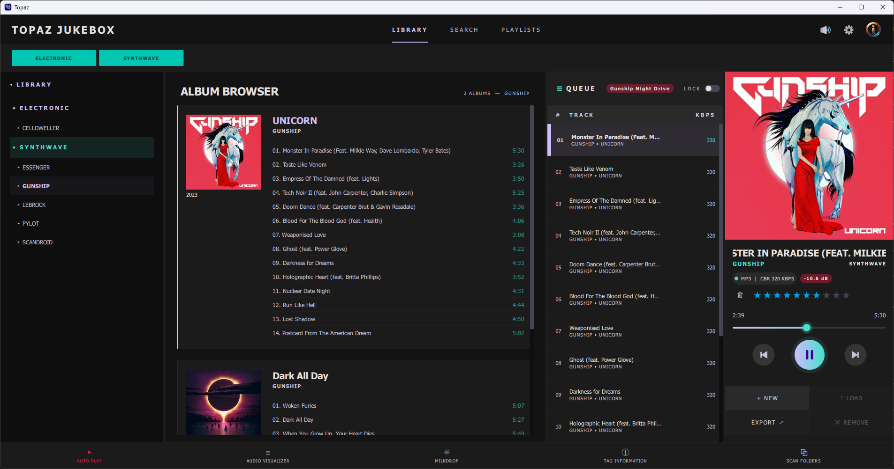

<h1 align="center">Topaz Jukebox</h1>

<p align="center">
  A desktop jukebox for your own music collection — FLAC, MP3 and Opus — for Windows and Linux.
</p>

<p align="center">
  <a href="https://github.com/crucifythemadness/Topaz/releases/latest"></a>
  
  <a href="LICENSE"></a>
  
</p>



<table>
  <tr>
    <td width="60%"></td>
    <td width="40%"></td>
  </tr>
  <tr>
    <td align="center"><sub>Playlists, queue and Now Playing</sub></td>
    <td align="center"><sub>Milkdrop visuals in a detachable pane</sub></td>
  </tr>
</table>

## Overview

Topaz plays the music you own, from your own disks. You tell it which folders hold your
music and which genres you care about; it scans them and organizes everything by
**Genre → Artist → Album**. You pick tracks into a **queue**, save queues as **playlists**,
and let it play — simple enough for a party, detailed enough for critical listening.

- **FLAC, MP3 and Opus**, with cover art, tags and bit rate shown as you play
- **Library browser** by genre, artist and album, plus full-text **search**
- **Playback queue** with drag & drop and reordering
- **Playlists** in the open XSPF format, with an **export** to a folder or USB stick
  (optionally converting FLAC/Opus to MP3)
- **Ratings** (1–10 stars) that survive a library rebuild
- **AUTO PLAY**: keeps the music going on its own, picking tracks by your rules
- **Crossfades** and **Auto Loudness Correction**
- An **audio visualizer** and **Milkdrop** visuals (via projectM)
- **Detachable panes** (big cover, visuals, tag information) for a second screen, and a
  full-screen mode
- **Backup and restore** of all settings, ratings and playlists in a single file
- **Never changes your music files** — everything Topaz remembers lives in its own folder
- **Portable**: no installer, runs from any folder or USB stick

The full manual is the **[Topaz User Guide](docs/Topaz%20User%20Guide.md)**. It is also
included as a PDF in every download.

## Download

Get the latest version from the **[Releases page](https://github.com/crucifythemadness/Topaz/releases/latest)**:

| Platform | File |
|---|---|
| Windows 10/11 (64-bit) | `Topaz-1.0.0-Windows-x64.7z` |
| Linux (64-bit, x86_64) | `Topaz-1.0.0-Linux-x64.7z` |

## Windows

### Requirements

- **Windows 10** (version 1809 or newer) or **Windows 11**, **64-bit** (x64)
- A graphics card with DirectX 11 support (any PC from the last decade)
- About **300 MB** of free disk space
- For Milkdrop visuals: a graphics driver with **OpenGL 3.3** or newer

### Installation

Topaz needs no installer.

1. Download `Topaz-1.0.0-Windows-x64.7z`.
2. Unpack it to any folder you like — your hard disk, another drive or a USB stick.
   Windows 11 can open `.7z` files directly (right-click → **Extract All**). On Windows 10,
   use the free [7-Zip](https://www.7-zip.org/).
3. Double-click **`Topaz.exe`**.

To remove Topaz, delete its folder. Your settings stay in `%LOCALAPPDATA%\Topaz\`; delete
that folder too if you want them gone.

> **"Windows protected your PC"?** Topaz is not digitally signed, so Microsoft Defender
> SmartScreen may warn you on the first start. Click **More info → Run anyway**.

## Linux

### Requirements

- A **64-bit (x86_64)** desktop Linux with **glibc 2.38 or newer** — for example
  Ubuntu 24.04 or newer and its flavours, Linux Mint 22 or newer, Debian 13 or newer, or
  Fedora 39 or newer
- **X11** or **Wayland**
- **PulseAudio** or **PipeWire** (with `pipewire-pulse`, the default on current distributions)
- About **500 MB** of free disk space
- For Milkdrop visuals: a graphics driver with **OpenGL 3.3 Core Profile** or newer. Check with
  `glxinfo -B | grep "core profile version"` (package `mesa-utils`).

**Tested on:** Linux Mint 22.2 (Cinnamon, X11, NVIDIA) and Ubuntu Studio (Wayland). Other
distributions that meet the requirements above should work, but haven't been tested yet.

Topaz brings its own Qt, projectM and GLEW libraries, so you don't need to install anything
else.

### Installation

1. Download `Topaz-1.0.0-Linux-x64.7z` and unpack it to any folder in your home directory:

   ```sh
   sudo apt install 7zip        # Ubuntu/Mint/Debian; on older releases: p7zip-full
   7z x Topaz-1.0.0-Linux-x64.7z
   ```

2. Make the start scripts executable (7-Zip archives don't keep Linux file permissions):

   ```sh
   cd Topaz
   chmod +x run-topaz.sh topaz-bin install-topaz-launcher.sh
   ```

3. Start Topaz:

   ```sh
   ./run-topaz.sh
   ```

   Always start it through `run-topaz.sh`, not `topaz-bin` directly: the script tells Topaz
   where its bundled libraries are.

4. Optional: add Topaz to your application menu and panel, with its icon:

   ```sh
   sh ./install-topaz-launcher.sh
   ```

   Run it again if you move the folder. `sh ./install-topaz-launcher.sh --remove` undoes it.

Settings are kept in `~/.config/Topaz/`. More details and troubleshooting tips are in
`README-Linux.txt` inside the folder.

## Optional add-ons

Topaz works out of the box. These optional add-ons unlock extra features. They are **not
included** for licensing reasons; download them yourself and place them **next to
`Topaz.exe`** (Windows) or **next to `topaz-bin`** (Linux).

| Add-on | Files | What it unlocks |
|---|---|---|
| [BASS Audio Library](https://www.un4seen.com/) | Windows: `bass.dll`, `bassflac.dll`, `bassopus.dll`<br>Linux: `libbass.so`, `libbassflac.so`, `libbassopus.so` | An alternative playback engine, needed for Auto Loudness Correction and the Replay Gain tag on export |
| [BASS_FX](https://www.un4seen.com/) | `bass_fx.dll` / `libbass_fx.so` | The "Consistent Background Music" loudness strategy |
| [ffmpeg](https://ffmpeg.org/) | `ffmpeg.exe` / `ffmpeg` (on Linux simply `sudo apt install ffmpeg`) | **Convert to MP3** when exporting a playlist. The build must include the LAME MP3 encoder. |
| Milkdrop presets | `.milk` files, freely available online | Milkdrop visuals. Add their folder in Setup → MILKDROP. |
| Hi-Res Audio logo | `Hi-Res_Audio.svg` | A Hi-Res badge for high-resolution tracks (see the User Guide) |

BASS is free for non-commercial use; see un4seen.com for its license terms.

## Documentation

- **[Topaz User Guide](docs/Topaz%20User%20Guide.md)** — everything you can do with Topaz,
  step by step (also as `Topaz User Guide.pdf` in each download)
- [Architecture and functional specification](architecture/AudioJukeboxTopaz.md) — for
  developers

## Building from source

Topaz is a C++17 / Qt 6 (QML) application built with CMake and Ninja.

- **Windows**: Qt 6.10.2 (MinGW 64-bit), MinGW 13.1, CMake, Ninja
- **Linux**: built in Docker (Ubuntu 24.04 + Qt 6.10.2) from [`Dockerfile.linux`](Dockerfile.linux)

projectM and GLEW are fetched automatically by CMake; KissFFT and miniz are included in
[`third_party/`](third_party/). The exact build and packaging commands for both platforms are in
[`CLAUDE.md`](CLAUDE.md).

## License

Copyright © 2026 CrucifyTheMadness

Topaz is free software: you can redistribute it and/or modify it under the terms of the
**GNU General Public License, version 3** as published by the Free Software Foundation. It is
distributed in the hope that it will be useful, but **without any warranty**; without even the
implied warranty of merchantability or fitness for a particular purpose. See [`LICENSE`](LICENSE)
for the full text.

### Third-party components

The release downloads include the following components, each under its own license:

| Component | Used for | License |
|---|---|---|
| [Qt 6.10.2](https://www.qt.io/) | Application framework, user interface, audio playback | [LGPL-3.0](https://www.qt.io/licensing/open-source-lgpl-obligations) |
| [FFmpeg](https://ffmpeg.org/) (bundled with Qt Multimedia) | Audio decoding | [LGPL-2.1+](https://ffmpeg.org/legal.html) |
| [projectM 4.1.7](https://github.com/projectM-visualizer/projectm) | Milkdrop visuals | [LGPL-2.1](https://github.com/projectM-visualizer/projectm/blob/master/LICENSE.txt) |
| [GLEW 2.2.0](https://github.com/nigels-com/glew) | OpenGL extension loading | [Modified BSD / MIT](https://github.com/nigels-com/glew/blob/master/LICENSE.txt) |
| [KissFFT](https://github.com/mborgerding/kissfft) | Audio visualizer (FFT) | [BSD-3-Clause](third_party/kissfft/LICENSES/BSD-3-Clause) |
| [miniz](https://github.com/richgel999/miniz) | Backup files (ZIP) | [MIT](third_party/miniz/LICENSE) |
| MinGW-w64 / GCC runtime (Windows), libstdc++ (Linux) | C++ runtime | GPL-3.0 with the GCC Runtime Library Exception; winpthreads: MIT |

The LGPL libraries are linked dynamically and ship as separate files (`.dll` / `.so`), so you
can replace them with your own builds. Their source code is available from the projects
linked above.

**Not included:** the BASS libraries, ffmpeg, Milkdrop presets and the Hi-Res Audio logo are
not part of Topaz and are never distributed with it. "Hi-Res Audio" is a trademark of the
Japan Audio Society. All other trademarks belong to their respective owners.

## Credits

Developed by [CrucifyTheMadness](https://github.com/crucifythemadness) as a vibe-coding
project, built entirely with Anthropic's Claude to show what today's AI models can do.
