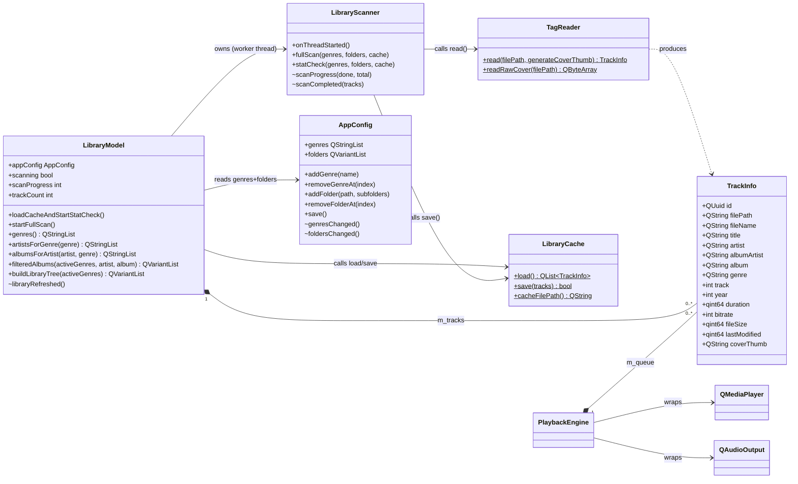

# References  
[Qt](https://en.wikipedia.org/wiki/Qt_(software))
[flac](https://en.wikipedia.org/wiki/FLAC)  
[mp3](https://en.wikipedia.org/wiki/MP3)
[ID3-Tag](https://de.wikipedia.org/wiki/ID3-Tag)
[FIFO](https://en.wikipedia.org/wiki/FIFO_(computing_and_electronics))
[Fade - audio engineering](https://en.wikipedia.org/wiki/Fade_(audio_engineering))
[Json](https://www.json.org/json-en.html)
[GUI](https://en.wikipedia.org/wiki/Graphical_user_interface)
[QML](https://en.wikipedia.org/wiki/QML)

# Abbreviations and definitions of terms  
- flac (Free Lossless Audio Codec)  
- mp3 (formally MPEG-1 Audio Layer III or MPEG-2 Audio Layer III)
- Topaz (Project name and also the Application name)

# Introduction and overview
Topaz is an audio jukebox which is a desktop app that can play audio files (*.flac and *.mp3) from a queue. The queue plays the audio files according to the FIFO principle. Optionally, the user can set whether the audio files should be played with fade-in and fade-out (Fade - audio engineering) or whether the audio files should be played to the end before the next audio file is played. The user can move audio files within the queue up and down, except the audio file that is currently playing. The audio files are stored within a main folder that Topaz can scan. Topaz has an application Json Config-File were the user can set the proper main folder path via GUI. Audio files are then organized under three levels. Genre, Album Artist and Album. At the Top are 30 toggle buttons (3 rows with 10 buttons over the whole application with) that are representing the genres. A genre is active when the button is pressed and all album artists, albums and audio files under this genre are now visible and selectable. Available Genres can be configured within the application config file. The application config file will be read at startup and each available genre will be connected with one toggle button. On the left side under the genre toggle buttons is a tree control that contains all available genres. The tree control has three levels (genre, album artist, album). Right from that is a section that can contain all albums, each with the cover and all the audio files, from a selected Genre or a selected Album artist. Alternatively the user can also just select one Album. Right from that is antother section with the audio file queue. The queue should display the Number when the Audio file will be played, the Album name, the Artist, the Name of the Audio file and the Audio file bitrate. Right from that is antother section that contains the cover and detail information of the audio file that is currently playing. All together we have 4 sections that are under the big genre toggle buttons. Each Audio file that Topaz played will be stored and saved automatically in a Json playlist file. The possibility to manage playlist files is in the section on the right side were the details of the currently playing Audio file are. The User can start a new playlist with a given name or the User can load an already existing playlist. That means that at the application startup the user has to decide to create a new playlist or load an exisisting playlist. If the User loads an existing playlist, Topaz will automatically start playing the first audio file from that playlist. Albums or Audio Files can be add to the queue via context menu (mouse right click) or via drag and drop. Topaz should be an application that has a moderate memory consumption. That means that unnecessary Album covers and Audio Files (ID3-Tag Informations) in Memory has to be unloaded.

# Essential requirements  
- Topaz will be a Qt application (GUI with QML or partially with QML)

## Supported application resolutions  
- 1920x1080  (auto-fullscreen when monitor is exactly this resolution)
- 1920x1200  (auto-fullscreen when monitor is exactly this resolution)
- 2560x1440  (auto-fullscreen when monitor is exactly this resolution)
- 3840x2160  (auto-fullscreen when monitor is exactly this resolution)
- 4096x2160
- Windowed fully resizable (minimum 1280 × 720)

# Use Cases

## UC-01 Browse by Genre

| Field | Detail |
|-------|--------|
| **Goal** | User filters the library tree and album browser by activating one or more genre toggle buttons. |
| **Actor** | User |
| **Precondition** | At least one genre is configured and the library has been scanned. |
| **Trigger** | User clicks a genre toggle button in the `GenreBar`. |

### Normal Flow

1. User clicks a genre button (e.g. "Techno").
2. `GenreBar` calls `lib.toggleGenre(index)`.
3. `LibraryData.toggleGenre()` flips the `active` flag in `genreModel`, rebuilds `activeGenreNames`, and clears `selectedGenre` / `selectedArtist` / `selectedAlbum`.
4. `LibraryTree.onLibraryChanged` fires → tree renders only active-genre sections.
5. `AlbumBrowser` receives `onActiveGenreNamesChanged` → schedules `_scheduleRefresh()` via `Qt.callLater` (deferred to the next event-loop tick so LibraryTree renders its frame first) → `currentAlbums = lib.filteredAlbums()` → `ListView` updates.
6. `AlbumBrowser` subtitle updates to reflect the new filter path (e.g. `TECHNO`).

### Alternate: Genre drill-down (tree click)

User clicks a genre header row in `LibraryTree`:
- `LibraryTree` calls `lib.selectGenre(name)`. Clicking the same genre again deselects it.
- `LibraryData.selectGenre()` sets `selectedGenre`, clears `selectedArtist` / `selectedAlbum`.
- `AlbumBrowser` receives `onSelectedGenreChanged` → `filteredAlbums()` narrows to that single genre only.
- Genre header highlights in `secondary` (teal) colour; all expanded artist nodes collapse.

### Alternate: Artist drill-down

After activating genres, the user clicks an artist in `LibraryTree`:
- `LibraryTree` calls `lib.selectArtist(name)` and toggles local expand state.
- `AlbumBrowser` receives `onSelectedArtistChanged` → `currentAlbums` narrows to that artist's albums only.

### Alternate: Album drill-down

User clicks an album row in `LibraryTree`:
- `LibraryTree` calls `lib.selectAlbum(title)`.
- `AlbumBrowser` receives `onSelectedAlbumChanged` → `currentAlbums` narrows to that single album.

### Empty-State Rules

- If no genres are active: `LibraryTree` shows "No genres active" hint; `AlbumBrowser` shows "No albums to show" hint.
- If a genre is active but has no artists yet: `LibraryTree` shows "No artists scanned yet" under that genre node.

---

## UC-02 Open Setup Dialog

| Field | Detail |
|-------|--------|
| **Goal** | User opens the setup dialog to configure genres and monitored folders. |
| **Actor** | User |
| **Precondition** | Application is running. |
| **Trigger** | User clicks the gear icon (⚙) in the `TopBar`. |

### Normal Flow

1. User clicks the ⚙ icon in the top-right toolbar.
2. `TopBar` emits `settingsRequested()`.
3. `Main.qml` handles `onSettingsRequested` → calls `setupDialog.open()`.
4. `SetupDialog` opens as a modal popup centered on the application window with a dark scrim behind it.
5. Dialog opens on the **GENRES** tab by default.
6. User switches tabs or closes the dialog with the ✕ button.

---

## UC-03 Configure Genres

| Field | Detail |
|-------|--------|
| **Goal** | User defines the list of genre names that appear as toggle buttons in `GenreBar`. |
| **Actor** | User |
| **Precondition** | Setup dialog is open on the GENRES tab. |
| **Trigger** | User interacts with genre management controls. |

### Normal Flow — Add genre

1. User types a genre name into the text input (e.g. "Techno").
2. User presses **Enter** or clicks **ADD**.
3. `SetupDialog.doAddGenre()` calls `appConfig.addGenre(name)`.
4. `AppConfig` performs a case-insensitive duplicate check, appends the name to `m_genres`, emits `genresChanged`, and auto-saves to `Topaz.config`.
5. `LibraryData` receives `genresChanged` → `rebuildGenreModel()` clears and repopulates `genreModel` from `appConfig.genres`.
6. `GenreBar` `Repeater` re-evaluates → the new genre button appears immediately.

### Normal Flow — Delete selected genre

1. User clicks a genre chip to select it (highlighted in `secondaryContainer` colour).
2. User clicks **DELETE SELECTED**.
3. `appConfig.removeGenreAt(index)` removes the entry, emits `genresChanged`, auto-saves.
4. `LibraryData.rebuildGenreModel()` fires; the chip disappears from `GenreBar`.

### Normal Flow — Delete all genres

1. User clicks **DELETE ALL**.
2. `appConfig.clearGenres()` empties the list, emits `genresChanged`, auto-saves.
3. `GenreBar` shows empty state; `LibraryTree` and `AlbumBrowser` show their no-genres hints.

### Rules

- Duplicate names (case-insensitive) are silently ignored.
- Genre names are stored in their original casing and displayed upper-cased in `GenreBar`.
- Maximum 30 genres are displayed in `GenreBar` (3 rows × 10 columns); additional genres are
  still stored but may not be visible until the layout is extended.

---

## UC-04 Configure File Monitoring Folders

| Field | Detail |
|-------|--------|
| **Goal** | User specifies which directories Topaz should scan for audio files (FLAC / MP3). |
| **Actor** | User |
| **Precondition** | Setup dialog is open on the FILE MONITORING tab. |
| **Trigger** | User interacts with folder management controls. |

### Normal Flow — Add folder

1. User clicks **ADD FOLDER**.
2. A native OS folder-picker dialog (`QtQuick.Dialogs.FolderDialog`) opens.
3. User selects a directory and confirms.
4. `FolderDialog.onAccepted` calls `appConfig.addFolder(selectedFolder, true)`.
5. `AppConfig` converts the `file://` URL to a local path via `QUrl::toLocalFile()`,
   performs a duplicate check, appends `{ "path": ..., "includeSubfolders": true }`, emits
   `foldersChanged`, and auto-saves.
6. The new row appears in the folder list with the **SUBFOLDERS** checkbox ticked.

### Normal Flow — Toggle subfolders

1. User clicks the checkbox in the **SUBFOLDERS** column of any folder row.
2. `appConfig.setFolderSubfolders(index, !current)` flips the flag, emits `foldersChanged`,
   auto-saves.
3. The checkbox visual updates immediately.

### Normal Flow — Delete selected folder

1. User clicks a row to select it (row highlighted with `p10` tint).
2. User clicks **DELETE SELECTED**.
3. `appConfig.removeFolderAt(index)` removes the entry, emits `foldersChanged`, auto-saves.

### Normal Flow — Delete all folders

1. User clicks **DELETE ALL**.
2. `appConfig.clearFolders()` empties the list, emits `foldersChanged`, auto-saves.

### Rules

- Duplicate paths (exact string match) are silently ignored.
- The `includeSubfolders` flag defaults to `true` when a folder is first added.

---

## UC-05 Scan Audio Directories

| Field | Detail |
|-------|--------|
| **Goal** | Topaz scans all configured folders for audio files whose genre matches a configured genre and populates the library. |
| **Actor** | User / System |
| **Precondition** | At least one genre and one folder are configured in `AppConfig`. |
| **Trigger** | User clicks **SCAN DIRECTORIES** in `BottomBar`, OR startup stat-check finds new/changed files. |

### Normal Flow — Full scan

1. `BottomBar` emits `scanRequested()`.
2. `Main.qml` calls `libraryModel.startFullScan()`.
3. `LibraryModel` copies genres + folders from `AppConfig`, emits `_requestFullScan` to worker thread.
4. `LibraryScanner.fullScan()` runs on the worker thread:
   a. Recursively walks each configured folder (respecting `includeSubfolders`).
   b. For each `*.mp3` / `*.flac` file: calls `TagReader::read()`.
   c. Compares the file's genre tag (case-insensitive trim) against configured genres. Skips unmatched files.
   d. Assigns a stable UUID (reused from cache if path is known).
   e. For the first track of each (albumArtist, album) pair: extracts and scales a 160×160 JPEG thumbnail.
   f. Emits `scanProgress(done, total)` periodically.
5. Scanner saves result to `Topaz.library.json` via `LibraryCache::save()`.
6. Scanner emits `scanCompleted(tracks)`.
7. `LibraryModel.onScanCompleted()` calls `beginResetModel/endResetModel`, replaces `m_tracks`, emits `libraryRefreshed()`.
8. `LibraryData._rebuildTree()` fires → `LibraryTree` and `AlbumBrowser` update.

### Normal Flow — Startup stat-check (hybrid strategy step 2)

1. `Main.qml Component.onCompleted` → `libraryModel.loadCacheAndStartStatCheck()`.
2. Cache is read synchronously from `Topaz.library.json` → displayed immediately (step 1 of hybrid strategy).
3. `statCheck` is dispatched to worker thread.
4. Worker validates each cached entry (file still exists, `lastModified` unchanged).
5. New files found in configured folders are scanned and added.
6. Deleted files are removed from the result.
7. Updated cache is saved and `scanCompleted` emitted.

### Empty-State Rules

- If no genres are configured: scan returns 0 tracks; user must configure genres first.
- If no folders are configured: scan returns 0 tracks; user must configure folders first.
- `BottomBar` SCAN DIRECTORIES button is visually disabled (label changes to "SCANNING…") while a scan is in progress.

### Genre Matching Rule (Version 1)

The genre tag value read from the audio file (TCON for MP3, GENRE for FLAC) is
compared **case-insensitively** against the configured genre names in `AppConfig`.

```
File tag:    "techno"        → normalised: "techno"
Configured:  ["Techno", …]  → normalised: ["techno", …]
Result:      match → include
```

Each audio file must have **exactly one genre** that matches a configured genre.
Multi-genre tags (delimited strings) are not parsed in version 1; the entire tag
value is compared as-is (after normalisation).

---

## UC-06 Startup Library Load

| Field | Detail |
|-------|--------|
| **Goal** | Topaz displays the library instantly from cache while a background check runs. |
| **Actor** | System |
| **Precondition** | `Topaz.library.json` exists and is valid. |
| **Trigger** | Application startup. |

### Normal Flow

1. `Main.qml Component.onCompleted` fires after QML engine is ready.
2. `libraryModel.loadCacheAndStartStatCheck()` reads `Topaz.library.json` synchronously on the main thread (< 100 ms for 12K entries).
3. `applyTracks()` populates `m_tracks` and emits `libraryRefreshed()` → UI is visible immediately.
4. In parallel (worker thread): stat-check begins silently.
5. If stat-check finds changes: `scanCompleted` is received on main thread → model is refreshed.

---

## UC-07 Runtime Directory Monitoring

| Field | Detail |
|-------|--------|
| **Goal** | Topaz automatically detects when audio files are added or removed while the application is running. |
| **Actor** | System |
| **Precondition** | At least one folder is configured; a scan has completed. |
| **Trigger** | `QFileSystemWatcher::directoryChanged` fires. |

### Normal Flow

1. `QFileSystemWatcher` (owned by `LibraryScanner` on the worker thread) watches all root configured folders.
2. OS signals a directory change.
3. A 2-second debounce timer (re)starts; rapid successive changes are coalesced.
4. Timer fires → `statCheck` is triggered automatically.
5. Updated library is emitted via `scanCompleted` → UI refreshes.

---

# GUI Architecture

## Design System

The visual language is the **"Technical Monolith"** dark theme defined in
`design/google-stitch/notes.md`. Key rules:

- **No-border rule** — major section boundaries are expressed through background colour
  shifts (surface hierarchy), never 1 px lines.
- **Surface hierarchy**: `surfaceContainerLowest` → `surface` → `surfaceContainerLow` →
  `surfaceContainerHigh` → `surfaceBright` from darkest to brightest.
- **Typography**: Manrope (headlines), Inter (body/labels), JetBrains Mono (technical
  data). These three fonts must be embedded as Qt resources — add them to
  `qt_add_qml_module(… RESOURCES fonts/…)` once the `.ttf` / `.otf` files are available.
  Qt falls back to system fonts (Segoe UI, Consolas) until then.

Reference files:

| File | Purpose |
|------|---------|
| `design/google-stitch/mockup.png` | Full-resolution visual mockup |
| `design/google-stitch/layout.html` | HTML prototype with Tailwind token mapping |
| `design/google-stitch/notes.md` | Design-system rules, colour tokens, component logic |

## QML Module Structure

All components are registered in the `Topaz` QML module
(`qt_add_qml_module`, URI `Topaz`, version `1.0`).

```
Topaz module
├── Theme.qml           singleton — all colour, typography, spacing, and radius tokens
├── AppConfig           C++ QML_ELEMENT — reads/writes Topaz.config JSON; exposes genres & folders
├── LibraryModel        C++ QML_ELEMENT — QAbstractListModel + scanner orchestration
│                         property AppConfig appConfig
│                         Q_INVOKABLE: loadCacheAndStartStatCheck(), startFullScan()
│                         Q_INVOKABLE queries: genres(), artistsForGenre(), albumsForArtist(), filteredAlbums(), buildLibraryTree()
├── LibraryData.qml     shared state model — genre toggle, selection, tree builder
│                         property AppConfig appConfig
│                         property LibraryModel libraryModel
├── Main.qml            ApplicationWindow root; owns AppConfig, LibraryData, LibraryModel, PlaybackEngine, PlaylistManager, SetupDialog, NewPlaylistDialog
├── SetupDialog.qml     Modal setup popup (tabs: GENRES | FILE MONITORING)
├── NewPlaylistDialog.qml Modal popup — user enters a name; calls PlaylistManager.createPlaylist(); shows MessageBox on name collision
├── MessageBox.qml      Themed single-message popup with OK button; reusable across the application
├── TopBar.qml          Header (logo | navigation tabs | icons + avatar)  height 64 px
│                         signal settingsRequested()  ← gear icon click
├── GenreBar.qml        3 × 10 genre toggle grid  (reads lib.genreModel, calls lib.toggleGenre)
├── LibraryTree.qml     Left sidebar  default width 286 px, user-resizable  (flat virtualised ListView; flatRows JS array; no nested Repeaters)
├── AlbumBrowser.qml    Center album list  flex-grow (absorbs all surplus width from window resize or panel drag)  (calls lib.filteredAlbums() via Qt.callLater; no engine prop)
├── AlbumCard.qml       Single album card delegate (cover + track listing; single-track drag & drop to queue; no selection; no context menus)
│                         property var engine  (optional; used for double-click add-to-queue and drag cursor override)
├── PlaybackQueue.qml   Queue panel  default width 374 px, user-resizable  (bound to PlaybackEngine model; DropArea; move/remove; shows activePlaylistName in header when set; shows LOCK PLAYLIST toggle when a playlist is active)
├── NowPlaying.qml      Right panel  default width 359 px, user-resizable  (bound to PlaybackEngine + PlaylistManager: art + transport + progress + playlists)
|                         property playlistManager PlaylistManager
|                         signal newPlaylistRequested()  <- "+ NEW" button click
|                         FileDialog loadPlaylistDialog <- opens on LOAD; default folder = playlistDirectory(); filter *.xml
|                         Playlist row 1: NEW | LOAD (clears active playlist first if one is loaded, then opens file dialog)
|                         Playlist row 2: EXPORT (not yet wired) | REMOVE (active only when playlist loaded; calls engine.clearQueue())
│                         signal newPlaylistRequested()  ← “+ NEW” button click
└── BottomBar.qml       Footer toolbar  height 56 px  (signal scanRequested; scanning property)
```

## LibraryModel Component

`LibraryModel` is a C++ `QAbstractListModel` subclass marked `QML_ELEMENT`.
It owns a `LibraryScanner` worker that lives on a dedicated `QThread`.  All
heavy I/O (tag reading, directory walking, JSON serialisation) runs on the
worker thread; the main thread only receives light result copies via Qt's
queued-connection mechanism.

### C++ class overview

| Class | File | Role |
|-------|------|------|
| `TrackInfo` | `trackinfo.h` | Flat data struct; the single record type in the library |
| `TagReader` | `tagreader.h/cpp` | Zero-dependency ID3v2 + FLAC tag reader; cover thumbnail generator |
| `LibraryCache` | `librarycache.h/cpp` | Atomic read/write of `Topaz.library.json` |
| `LibraryScanner` | `libraryscanner.h/cpp` | Worker: directory walk, genre filter, QFileSystemWatcher |
| `LibraryModel` | `librarymodel.h/cpp` | QAbstractListModel + Q_INVOKABLE query helpers exposed to QML |
| `PlaylistManager` | `playlistmanager.h/cpp` | XSPF playlist file creation; path-portability helpers |

### TagReader — supported formats

| Format | Tag standard | Fields read |
|--------|-------------|-------------|
| MP3 | ID3v2.2, ID3v2.3, ID3v2.4 | TIT2, TPE1, TPE2, TALB, TRCK, TCON, TLEN, TYER/TDRC, APIC |
| FLAC | Vorbis Comment + STREAMINFO + PICTURE | TITLE, ARTIST, ALBUMARTIST, ALBUM, TRACKNUMBER, GENRE, DATE |

**Bitrate and duration for MP3**: the first MPEG frame header (past the ID3v2 tag) is
always scanned to determine bitrate, since ID3v2 has no dedicated bitrate frame. Duration
is taken from the `TLEN` frame when present; otherwise it is estimated from the same
frame header scan:
1. Scan past ID3v2 tag to first MPEG sync word; read bitrate/sample-rate from the frame header.
2. Check for Xing/Info VBR header → use `frame_count × samples_per_frame / sample_rate`.
3. CBR fallback → `audio_bytes × 8 / bitrate`.

**Cover thumbnails**: extracted from APIC (MP3) or PICTURE (FLAC), scaled to
160×160 JPEG via `QImage`, encoded as Base64. Only one thumbnail is generated
per `(albumArtist, album)` pair; all other tracks in the same album store an
empty `coverThumb`. Passed to `AlbumCard` as a `data:image/jpeg;base64,…` URL.

**Full-resolution cover** (`readRawCover`): a separate static method added for
the `NowPlaying` panel. It re-opens the file, locates the APIC (MP3) or PICTURE
(FLAC) block, and returns the raw embedded image bytes — no scaling. Called
off-thread by `PlaybackEngine` via `QtConcurrent::run` when the current track
changes (see `PlaybackEngine::currentLargeCoverSource`).

### LibraryModel public API

| Method / Property | Description |
|-------------------|-------------|
| `appConfig` | Bound AppConfig instance (set from Main.qml) |
| `scanning` | `true` while a scan is running |
| `scanProgress` | 0–100 completion percentage |
| `trackCount` | Number of tracks currently in the model |
| `loadCacheAndStartStatCheck()` | Load cache instantly, then dispatch stat-check |
| `startFullScan()` | Trigger a full rescan on the worker thread |
| `genres()` | Distinct genre strings present in the library |
| `artistsForGenre(genre)` | Album artists for a genre, sorted |
| `albumsForArtist(artist, genre)` | Album titles for an artist, sorted |
| `filteredAlbums(activeGenres, selectedArtist, selectedAlbum)` | Album display objects for AlbumBrowser. **Single O(N_tracks) pass** using `QHash` to group tracks by `(albumArtist\|album)` key; cover thumb collected in the same pass; no per-album full rescan. Replaces the former O(N_tracks × N_albums) three-pass algorithm. |
| `buildLibraryTree(activeGenres)` | **Single-pass** tree builder: returns `[ { genre, artists: [ { name, albums: [{title}] } ] } ]` for `LibraryData._rebuildTree()`. One O(N_tracks) scan replaces the former N_genres + N_artists separate full-list scans. |
| `coverThumbForAlbum(album, albumArtist)` | Base64 thumbnail for an album |
| `libraryRefreshed()` signal | Emitted after cache load or scan complete |

### Library cache format — `Topaz.library.json`

Stored alongside `Topaz.config` in `QStandardPaths::AppConfigLocation`.

```json
{
  "version": 1,
  "tracks": [
    {
      "id":           "550e8400-e29b-41d4-a716-446655440000",
      "filePath":     "C:/Music/Electronic/Techno/Artist/Album/01_Track.flac",
      "fileName":     "01_Track.flac",
      "title":        "Track Title",
      "artist":       "Artist Name",
      "albumArtist":  "Album Artist",
      "album":        "Album Name",
      "genre":        "Techno",
      "track":        1,
      "year":         2018,
      "duration":     234000,
      "bitrate":      1024,
      "fileSize":     54321678,
      "lastModified": 1718400000000,
      "coverThumb":   "" 
    }
  ]
}
```

**Cover storage**: `coverThumb` is populated for the first track of each
`(albumArtist, album)` pair; all other tracks have an empty string.
An average JPEG thumbnail (160×160, quality 80) is ≈ 10 KB; Base64-encoded ≈ 14 KB.
For 500 albums: ≈ 7 MB total cache size — well within acceptable range.

### Data Flow: Library Scan

```
BottomBar.scanRequested()
   │
   ▼
Main.qml → libraryModel.startFullScan()
   │  copies appConfig.genres + folders
   │  emit _requestFullScan (queued → worker thread)
   ▼
LibraryScanner.fullScan() [worker thread]
   ├── walk folders (recursive per config)
   ├── for each *.mp3 / *.flac:
   │     TagReader::read(path, needCover)
   │     genre filter (case-insensitive match)
   │     assign stable UUID from cache or new QUuid
   │     deduplicate covers: one thumb per (albumArtist, album)
   │     emit scanProgress(done, total)
   ├── LibraryCache::save(result) → Topaz.library.json
   └── emit scanCompleted(tracks)
          │ (queued → main thread)
          ▼
LibraryModel.onScanCompleted()
   ├── beginResetModel / endResetModel → updates QML ListView delegates
   ├── emit trackCountChanged()
   └── emit libraryRefreshed()
          │
          └──► LibraryData._rebuildTree()
                   └── LibraryTree.activeGenres refreshes
                       AlbumBrowser.currentAlbums refreshes
```

### Data Flow: Startup (Hybrid Strategy)

```
Main.qml Component.onCompleted
   │
   ▼
libraryModel.loadCacheAndStartStatCheck()
   │
   ├── Step 1: LibraryCache::load() ← synchronous, main thread
   │     < 100ms for 12K entries
   │     applyTracks() → libraryRefreshed() → UI displays cached data
   │
   └── Step 2: emit _requestStatCheck (queued → worker thread)
               LibraryScanner.statCheck()
               │  validate each cached entry (file exists, lastModified unchanged)
               │  find new files in configured folders
               │  remove deleted entries
               └── emit scanCompleted → model refresh (only if changes found)
```

```
[Runtime] QFileSystemWatcher.directoryChanged
   │  (debounced 2 s)
   ▼
LibraryScanner.statCheck() → same flow as startup step 2
```

`AppConfig` is a C++ `QObject` subclass marked with `QML_ELEMENT`.  It is
instantiated once in `Main.qml` (`AppConfig { id: appConfig }`) and passed by
reference to `LibraryData` and `SetupDialog`.

### Responsibilities

- Load `Topaz.config` from disk at construction time.
- Expose `genres` (`QStringList`) and `folders` (`QVariantList`) as QML-readable
  properties with change notifications.
- Provide `Q_INVOKABLE` mutators that update in-memory state, emit the appropriate
  change signal, and call `save()` atomically.
- Convert `file://` URLs (returned by `FolderDialog`) to local paths via
  `QUrl::toLocalFile()`.

### Config file location

```
Windows:  %APPDATA%\Topaz\Topaz\Topaz.config
Linux:    ~/.config/Topaz/Topaz.config
macOS:    ~/Library/Preferences/Topaz/Topaz.config
```

(Determined at runtime by `QStandardPaths::AppConfigLocation`.)

### Config file format — `Topaz.config`

```json
{
    "genres": [
        "Techno",
        "IDM",
        "Drone"
    ],
    "folders": [
        { "path": "C:/Music/Electronic", "includeSubfolders": true  },
        { "path": "C:/Music/Jazz",       "includeSubfolders": false }
    ],
    "windowWidth":        1920,
    "windowHeight":       1080,
    "libraryTreeWidth":   286,
    "playbackQueueWidth": 374,
    "nowPlayingWidth":    359
}
```

### AppConfig public API

| Method | Description |
|--------|-------------|
| `addGenre(name)` | Append genre (deduplicates case-insensitively); auto-saves. |
| `removeGenreAt(index)` | Remove genre by index; auto-saves. |
| `clearGenres()` | Remove all genres; auto-saves. |
| `addFolder(rawPath, includeSubfolders)` | Append folder (deduplicates by path); auto-saves. |
| `removeFolderAt(index)` | Remove folder by index; auto-saves. |
| `clearFolders()` | Remove all folders; auto-saves. |
| `setFolderSubfolders(index, flag)` | Toggle the includeSubfolders flag; auto-saves. |
| `saveLayout(windowWidth, windowHeight, libraryTreeWidth, playbackQueueWidth, nowPlayingWidth)` | Persist the current window size and resizable panel widths in a single atomic JSON write. Called from QML via a 500 ms debounce timer on every resize event. Window dimensions are not overwritten while in fullscreen. |
| `save()` | Persist current state to `Topaz.config` (called automatically by all mutators). |

## Data Flow: Genre Filter (GenreBar toggle)

```
User click
   │
   ▼
GenreBar.onClicked
   │  lib.toggleGenre(index)
   ▼
LibraryData
   ├── genreModel.setProperty(index, "active", ...)
   ├── activeGenreNames = [rebuilt array]
   ├── selectedGenre  = ""    ← property-change notification fires
   ├── selectedArtist = ""
   └── selectedAlbum  = ""
   └── _rebuildTree()  → library = [active genres with artists/albums]
          │
          ├──► LibraryTree.onLibraryChanged
          │        → activeGenres = lib.library
          │        → _rebuildFlatList() rebuilds flat JS array (pure JS, no C++ calls)
          │        → ListView renders only visible rows (virtualised, ~10-15 delegates)
          │        Note: onActiveGenreNamesChanged NOT wired to LibraryTree — avoids a
          │        second rebuild with stale lib.library before _rebuildTree() completes.
          │
          └──► AlbumBrowser.Connections.onActiveGenreNamesChanged
                   └── Qt.callLater(_scheduleRefresh)
                           (deferred: frame renders first, then filteredAlbums() runs)
                           └── ListView.model = currentAlbums  →  UI updates
```

## Data Flow: Genre Drill-down (LibraryTree click)

```
User clicks genre header row in LibraryTree
   │
   ▼
LibraryTree._selectGenre(genre)
   ├── expandedArtists = {}   (collapse all)
   │      → onExpandedArtistsChanged → _rebuildFlatList()
   │          (rebuilds flatRows JS array, ListView updates instantly)
   └── lib.selectGenre(genre)
          │
          ▼
      LibraryData.selectGenre()
          ├── selectedGenre  = genre  (toggle: clears if already selected)
          ├── selectedArtist = ""
          └── selectedAlbum  = ""
                 │  (no lib.library change → no _rebuildFlatList() triggered)
                 │  (LibraryTree delegate bindings on lib.selectedGenre update reactively)
                 │
                 └──► AlbumBrowser.Connections.onSelectedGenreChanged
                          └── Qt.callLater → currentAlbums = lib.filteredAlbums()
```

## Data Flow: Genre Configuration

```
TopBar gear click
   │  settingsRequested()
   ▼
Main.qml
   │  setupDialog.open()
   ▼
SetupDialog (GENRES tab)
   │  appConfig.addGenre(name)  /  removeGenreAt(i)  /  clearGenres()
   ▼
AppConfig (C++)
   ├── mutates m_genres
   ├── save()  →  Topaz.config written to disk
   └── emit genresChanged()
          │
          └──► LibraryData.rebuildGenreModel()
                   ├── _genreModel.clear()
                   ├── _genreModel.append({name, active:false}) for each genre
                   ├── activeGenreNames = []
                   └── selectedArtist / selectedAlbum = ""
                            │
                            └──► GenreBar Repeater re-evaluates
                                 LibraryTree / AlbumBrowser update via existing bindings
```

## Data Flow: Folder Configuration

```
SetupDialog (FILE MONITORING tab)
   │  ADD FOLDER  →  FolderDialog (native OS picker)
   │  onAccepted: appConfig.addFolder(selectedFolder, true)
   ▼
AppConfig (C++)
   ├── QUrl::toLocalFile() converts file:// URL to local path
   ├── mutates m_folders
   ├── save()  →  Topaz.config written to disk
   └── emit foldersChanged()
          │
          └──► SetupDialog folderList.model (bound to appConfig.folders)
                   └── ListView updates immediately

Next scan will pick up the new folder automatically.
```


## Supported Resolutions → Adaptive Layout Strategy

| Resolution | Startup behaviour | ColumnLayout behaviour |
|-----------|-------------------|------------------------|
| 1280 × 720 (minimum) | Windowed | All four panels visible; minimum enforced |
| 1920 × 1080 | **Auto-fullscreen** (`Window.FullScreen`) | Design baseline — all four panels fully visible |
| 1920 × 1200 | **Auto-fullscreen** (`Window.FullScreen`) | Extra vertical space absorbed by AlbumBrowser |
| 2560 × 1440 | **Auto-fullscreen** (`Window.FullScreen`) | Font scale and spacing scale up proportionally (future) |
| 3840 × 2160 | **Auto-fullscreen** (`Window.FullScreen`) | Font scale and spacing scale up proportionally (future) |
| 4096 × 2160 | Windowed 1920 × 1080 | AlbumBrowser gains a 2-column card grid (future) |

**Startup logic** (`Main.qml`):
```qml
visibility: ((Screen.width === 1920 && Screen.height === 1080) ||
             (Screen.width === 1920 && Screen.height === 1200) ||
             (Screen.width === 2560 && Screen.height === 1440) ||
             (Screen.width === 3840 && Screen.height === 2160))
            ? Window.FullScreen : Window.Windowed
width:  1920
height: 1080
minimumWidth:  1280
minimumHeight:  720
```

> Topaz starts fullscreen when the monitor is exactly 1920×1080, 1920×1200, 2560×1440, or 3840×2160.
> On all other resolutions (including 4096×2160) it starts windowed at 1920×1080.
> AlbumBrowser absorbs surplus width as the user resizes.

### Panel layout — `SplitView`

The four main panels (LibraryTree, AlbumBrowser, PlaybackQueue, NowPlaying) are
arranged in a horizontal `SplitView` (Qt Quick Controls 2).  A 5 px drag handle
sits between each pair of adjacent panels; its colour follows the surface
hierarchy tokens (`surfaceContainerLow` at rest → `surfaceContainerHigh` on
hover → `secondary` teal when actively dragged).

| Panel | Default width | Minimum width | Size behaviour |
|-------|--------------|---------------|----------------|
| LibraryTree | 286 px | 160 px | user-resizable |
| AlbumBrowser | — | 400 px | `SplitView.fillWidth: true` — absorbs all surplus |
| PlaybackQueue | 374 px | 240 px | user-resizable |
| NowPlaying | 359 px | 280 px | user-resizable |

When the application window is widened or narrowed, only AlbumBrowser grows or
shrinks.  Resizing a panel handle narrows AlbumBrowser accordingly, down to its
400 px minimum.

### Layout persistence

The window size and the three resizable panel widths are persisted in
`Topaz.config` so that the layout is restored exactly on the next startup.

**Save mechanism** — `Main.qml` watches `onWidthChanged` on the
`ApplicationWindow` (for window resizing) and on each resizable panel (for
handle dragging). All of these restart a single 500 ms debounce `Timer`.
When the timer fires it calls `appConfig.saveLayout(...)` which writes all five
values (`windowWidth`, `windowHeight`, `libraryTreeWidth`, `playbackQueueWidth`,
`nowPlayingWidth`) in one atomic JSON write. While in fullscreen mode the stored
window dimensions are not overwritten.

**Restore mechanism** — On startup, `AppConfig::load()` reads the five values
from JSON (falling back to the design-baseline defaults when absent). `Main.qml`
binds `width: appConfig.windowWidth` and `height: appConfig.windowHeight`, and
each resizable panel binds `SplitView.preferredWidth` to the corresponding
appConfig property. `SplitView` breaks those QML bindings the first time the
user drags a handle, taking over management of `preferredWidth` from that point
onward.

## Performance Design

### Album cover memory

Every `Image` element that displays an album cover sets `sourceSize` to the
**display size** (e.g., `sourceSize.width: 160; sourceSize.height: 160`).
Qt decodes the PNG at that resolution instead of keeping the full-resolution
bitmap in memory.  A 1400 × 1400 px cover therefore occupies ≈ 100 KB instead
of ≈ 7.8 MB.

```qml
// AlbumCard.qml — canonical pattern
Image {
    sourceSize.width:  160
    sourceSize.height: 160
    asynchronous: true
    fillMode: Image.PreserveAspectCrop
}
```

### Delegate recycling

`AlbumBrowser` and `PlaybackQueue` use `ListView` with `cacheBuffer` set
conservatively (200 px and 120 px respectively). Off-screen delegates are
released automatically; only visible items remain instantiated.

### Lazy cover loading

When the file-system backend is connected, the `ID3Info.Cover` (`QPixmap`)
will be loaded on demand and cleared when the containing album scrolls
permanently out of the `cacheBuffer` zone.  An LRU cover cache (capacity
configurable via the app JSON config) will be introduced at that point.

# Data model

## Class diagram

> The architecture has been refactored from separate entity classes (Genre,
> AlbumArtist, Album, ID3Info) to a flat `TrackInfo` struct for version 1.
> This avoids object-graph overhead for 12K+ entries while retaining all
> required data.  The logical entities (Genre, AlbumArtist, Album) exist as
> distinct string values within each `TrackInfo` and can be re-introduced as
> proper entity classes in a future version if needed (e.g., for user-editable
> metadata or playlist enrichment).



---

## UC-06 Add a Track to the Playback Queue

| Field | Detail |
|-------|--------|
| **Goal** | User adds a single track to the playback queue via drag & drop. |
| **Actor** | User |
| **Precondition** | At least one album is visible in `AlbumBrowser`. |
| **Trigger** | User drags a track row from `AlbumCard` to `PlaybackQueue`. |

### Normal Flow — Drag from track row to queue

1. User presses and holds the left button on a track row and moves the mouse more than 8 px.
2. `trackMA.onPositionChanged` sets `trackRow.Drag.active = true`, calls `engine.setDragCopyCursor()` to display a system-wide `DragCopyCursor` (➕ with arrow), and on every subsequent `positionChanged`, updates `Drag.hotSpot` to the cursor's current position in `trackRow`-local coordinates:
   ```
   scenePt = mapToItem(null, mouse.x, mouse.y)   // cursor in scene space
   rowPt   = trackRow.mapToItem(null, 0, 0)       // trackRow origin in scene space
   Drag.hotSpot = scenePt - rowPt                 // hotspot follows cursor
   ```
   `trackRow` itself never moves from its layout position. The hotspot tracking is what causes Qt's drop system to report the drag to DropAreas under the actual cursor.
3. As the cursor enters `PlaybackQueue`, its `DropArea.containsDrag` becomes `true` — the panel highlights in secondary colour.
4. User releases. `DropArea.onDropped` reads `drop.source.trackData`, calls `engine.addTracks([trackData])`, accepts `Qt.CopyAction`.
5. `trackMA.onReleased` calls `engine.restoreOverrideCursor()` to revert the cursor. `PlaybackEngine` appends the track; `PlaybackQueue` ListView updates.

### Normal Flow — Double-click track to add to queue

1. User double-clicks a track row.
2. `trackMA.onDoubleClicked` calls `root.engine.addTracks([modelData])` directly.
3. Same result as a successful drag-drop, without leaving the album browser.

### Why dynamic `Drag.hotSpot` is required

Qt's DropArea fires when the drag source item's hotspot (`item.mapToScene(Drag.hotSpot)`) is inside the DropArea's scene bounds. If `trackRow` never moves (it stays in the AlbumBrowser layout), the hotspot stays in the AlbumBrowser area and never reaches the PlaybackQueue DropArea — so the drop never triggers. Updating `Drag.hotSpot` every `positionChanged` to equal `cursorScenePos - trackRowScenePos` ensures the absolute hotspot position always matches the mouse cursor, regardless of where `trackRow` sits in the scene.

### Why internal drag (not `Drag.Automatic`)

`Drag.Automatic` uses the OS drag-and-drop mechanism and requires `Drag.mimeData`. It is designed for dragging between different windows or applications. Our source and target are both inside the same `ApplicationWindow`, so **internal drag** (`Drag.active` / `drop.source`) is the correct pattern.

### Drag key separation

The application has two distinct drag flows. Only the AlbumCard → queue flow uses Qt's
`Drag`/`DropArea` mechanism. The queue-internal reorder uses pure mouse tracking (see UC-11)
and does **not** involve `Drag.active` or `DropArea`.

| Flow | Mechanism | `Drag.keys` / DropArea |
|------|-----------|------------------------|
| Add to queue (AlbumCard → PlaybackQueue) | Qt internal drag (`Drag.active` + `DropArea`) | `Drag.keys: ["externalDrop"]`; DropArea in `PlaybackQueue`: `keys: ["externalDrop"]` |
| Queue reorder (within PlaybackQueue) | Pure mouse tracking in `dragHandleMA` | No `Drag.active`, no `DropArea` — `queueArea.reorderFrom/To` properties + single `insertBar` |

### Why `HoverHandler` instead of `MouseArea` for card hover

`AlbumCard` originally used a full-card `MouseArea` (`cardHover`) for the background-colour hover effect. Because it was declared **last** in the component (therefore topmost in z-order), it intercepted every `onPressed` before the per-track `trackMA` could see it. Even with `propagateComposedEvents: true`, non-composed events (`pressed`, `positionChanged`, `released`) are **not** propagated, so drag could never start.

The fix: replace `cardHover` MouseArea with `HoverHandler`. `HoverHandler` is a pointer-handler (not a MouseArea) — it observes hover without consuming any press or move events, letting `trackMA` receive them unobstructed.

### Why `preventStealing: true` on `trackMA`

The `albumList` ListView is interactive (flick-scrollable). Without `preventStealing: true`, once the user moves the mouse a few pixels after pressing, the ListView's flick handler can steal the gesture from `trackMA`, preventing `onPositionChanged` from firing and the drag from starting. `preventStealing: true` tells the parent Flickable/ListView to not take the event once `trackMA` has accepted the press.

### Design constraints (performance)

- **No multi-selection**: `AlbumCard` carries no selection state — no `selectedIndices` JS object, no Ctrl+click logic.
- **No context menus**: `QtQuick.Controls.Menu` removed from `AlbumCard`. Each `Menu` is backed by a `QQuickPopup` overlay; instantiating dozens of them per genre change was the primary source of UI lag.
- **No album drag**: the cover area is not a drag source; only individual track rows are draggable.
- **Minimal engine reference in `AlbumCard`**: `engine` is an optional `property var` on `AlbumCard`, used only for double-click add-to-queue and the drag cursor override via `setDragCopyCursor` / `restoreOverrideCursor`. `AlbumBrowser` itself has no engine reference. Setting the cursor via a C++ invokable (`QGuiApplication::setOverrideCursor`) is necessary because a QML `cursorShape` binding on `trackMA` is ineffective once the mouse leaves the `MouseArea`'s bounds during a drag — the global override persists regardless of which item is under the cursor.

---

## UC-11 Reorder Tracks in the Playback Queue

| Field | Detail |
|-------|--------|
| **Goal** | User reorders a non-playing track in the queue by dragging it to a new position. |
| **Actor** | User |
| **Precondition** | At least two tracks are in the queue; the track to move is not currently playing. |
| **Trigger** | User presses and drags the drag-handle (\u283f) of a queue row. |

### Normal Flow

1. User hovers over a non-playing queue row — the drag handle (\u283f, braille six-dot glyph) is always present at z:2 in the position-number column (visible for all non-playing rows).
2. User presses the handle. `dragHandleMA.onPressed` sets `queueArea.reorderFrom = index` and `queueArea.reorderTo = index`.
3. User moves the mouse. `dragHandleMA.onPositionChanged` fires continuously (`preventStealing: true` prevents the ListView from stealing the gesture):
   - Maps the cursor to `queueList.contentItem` coordinate space, which automatically accounts for scroll offset.
   - Computes `newTo = Math.floor(pt.y / 68)`, clamped to `[0, queueCount-1]`.
   - Sets `queueArea.reorderTo = newTo`.
4. The source row dims to 45 % opacity (`opacity: queueArea.reorderFrom === index ? 0.45 : 1.0`).
5. A single 2 px `insertBar` Rectangle (z:10, outside delegates, inside `queueArea`) shows the insert position:
   - Moving down (from < to): bar at `(to + 1) * 68 - queueList.contentY` (below target row).
   - Moving up   (from > to): bar at `to * 68 - queueList.contentY` (above target row).
6. User releases. `dragHandleMA.onReleased` resets `reorderFrom`/`reorderTo` to `−1` (bar disappears), then calls `engine.moveTrack(from, to)`.
7. `PlaybackEngine.moveTrack()` calls `beginMoveRows` / `endMoveRows`; the `ListView` animates the row to its new position.

### Alternate: Released on same row or cancelled

If `from === to`, `moveTrack` is not called. If released outside the queue area, the drag terminates the same way.

### Why pure mouse tracking instead of `Drag`/`DropArea`

Using `Drag.active` on a ListView delegate and per-delegate `DropArea` targets is unreliable because:
- The drag handle's `visible` gate (`rowHover.containsMouse`) causes the handle to hide itself at z:2, since `dragHandleMA` above it consumes hover events, setting `rowHover.containsMouse = false` at the moment the user hovers over the handle — a visibility deadlock.
- DropAreas inside delegate items are sibling items of the drag source. Qt's per-delegate DropArea approach works for simple cases but is fragile in a scrollable ListView with dynamic model indices.

Pure mouse tracking avoids both issues: `onPositionChanged` fires reliably as long as the button is pressed, regardless of what is under the cursor. `mapToItem(queueList.contentItem, ...)` gives the exact content-space Y coordinate from which the target index is computed directly.

### Design decisions

- **Drag handle always visible** (`visible: !model.playing`): no hover dependency; this avoids the z-order hover-stealing deadlock described above. The glyph colour changes on hover/drag for visual feedback without affecting interactivity.
- **`preventStealing: true`**: prevents the `ListView`'s flick handler from stealing the press from `dragHandleMA`.
- **Playing row excluded**: `dragHandle.visible: !model.playing`, mirroring the constraint on `moveUp`/`moveDown`.
- **Single insert bar**: one shared `Rectangle` (z:10) in `queueArea` replaces per-delegate DropArea highlighting. Positioning is computed from `reorderTo * 68 - queueList.contentY`, which is always in the correct view-space coordinate.

---

## UC-07 Playback Controls

| Field | Detail |
|-------|--------|
| **Goal** | User controls audio playback (play, pause, previous, next, seek). |
| **Actor** | User |
| **Precondition** | At least one track is in the queue. |
| **Trigger** | User interacts with transport controls in `NowPlaying.qml`. |

### Normal Flow — Play / Pause

1. User clicks the ▶ / ⏸ button.
2. `NowPlaying` calls `engine.togglePlay()`.
3. `PlaybackEngine` toggles `QMediaPlayer` between playing and paused states.
4. `engine.isPlaying` property changes → button icon updates immediately.

### Normal Flow — Next / Previous

- **Next** (⏭): `engine.next()` → loads `m_currentIndex + 1`, calls `play()`.
- **Previous** (⏮): `engine.previous()`:
  - If `position > 3 s` → seeks to `0` (restart current track).
  - Otherwise → loads `m_currentIndex - 1`, calls `play()`.

### Normal Flow — Seek

1. User clicks or drags the progress bar thumb in `NowPlaying`.
2. `NowPlaying` calls `engine.seek(fraction * engine.duration)`.
3. `QMediaPlayer.setPosition()` updates playback position.
4. `engine.position` notifies → `positionString` and `progressBar.progress` update.

### Normal Flow — Track ends automatically

1. `QMediaPlayer` emits `mediaStatusChanged(EndOfMedia)`.
2. `PlaybackEngine.advanceToNext()` increments `m_currentIndex`, loads the next track, calls `play()`.
3. If the queue is exhausted, playback stops; `isPlaying` → `false`.

### Displayed information

| NowPlaying element | Source |
|-------------------|--------|
| Album art | `engine.currentLargeCoverSource` (full-res, loaded async); falls back to `engine.currentCoverSource` (160 px thumb) until ready |
| Track title | `engine.currentTitle` |
| Artist | `engine.currentArtist` (artist with fallback to albumArtist) |
| Format badge | `engine.currentFormat` + `engine.currentBitrate` KBPS |
| Elapsed time | `engine.positionString` ("M:SS") |
| Total time | `engine.durationString` ("M:SS") |
| Progress ratio | `engine.position / engine.duration` |

---

## PlaybackEngine Component

`PlaybackEngine` is a C++ `QAbstractListModel` subclass marked `QML_ELEMENT`.
It serves as **both the queue model** (rows = `TrackInfo` records) and the **playback controller** (owns `QMediaPlayer` + `QAudioOutput`).  The queue is the single source of truth; `PlaybackQueue.qml` binds its `ListView.model` directly to the engine instance.

### Public API

| Method / Property | Type | Description |
|-------------------|------|-------------|
| `currentIndex` | `int` | Index of the currently loaded track (−1 = nothing) |
| `isPlaying` | `bool` | `true` when `QMediaPlayer` is in `PlayingState` |
| `position` | `qint64` | Playback position in milliseconds |
| `duration` | `qint64` | Duration of current track in milliseconds |
| `positionString` | `QString` | `position` formatted as "M:SS" |
| `durationString` | `QString` | `duration` formatted as "M:SS" |
| `currentTitle` | `QString` | Title of the current track |
| `currentArtist` | `QString` | artist (falls back to albumArtist) of the current track |
| `currentAlbum` | `QString` | Album name of the current track |
| `currentFormat` | `QString` | "FLAC" or "MP3" derived from file extension |
| `currentBitrate` | `int` | kbps bitrate of the current track |
| `currentCoverSource` | `QString` | `data:image/jpeg;base64,…` cover thumbnail URL — 160×160 px, available immediately |  
| `currentLargeCoverSource` | `QString` | Full-resolution cover as `data:image/jpeg;base64,…`, loaded asynchronously via `QtConcurrent::run` + `QFutureWatcher`. Empty until the background task completes; `NowPlaying.qml` falls back to `currentCoverSource` in the interim. |
| `queueCount` | `int` | Number of tracks in the queue |
| `activePlaylistName` | `QString` | File name (with `.xml` extension) of the playlist currently associated with the queue; empty when no playlist is active. Displayed in the `PlaybackQueue` header. Cleared automatically when the queue is cleared. |
| `playlistLocked` | `bool` | When `true`, queue mutations (add, remove, move) do **not** update the XSPF file on disk. Default: `false`. Reset to `false` automatically when `activePlaylistName` changes or `clearQueue()` is called. When set from `true` → `false`, the XSPF is immediately rewritten with the current queue contents. |
| `playlistManager` | `PlaylistManager*` | Reference to the `PlaylistManager` instance set from `Main.qml`. Used internally to sync the XSPF file when tracks are added, removed, or reordered. |
| `addTrack(map)` | invokable | Append a single track map to the queue. If `activePlaylistName` is set **and** `playlistLocked` is `false`, calls `playlistManager.appendTrack()` to persist the change. |
| `addTracks(list)` | invokable | Batch-append a QVariantList of track maps. Calls `appendTrack` for each new entry when a playlist is active and not locked. |
| `removeAt(index)` | invokable | Remove track at given queue index. Captures `filePath` before removal; calls `playlistManager.removeTrackByPath()` when a playlist is active and not locked. |
| `moveUp(index)` | invokable | Swap track with predecessor (not allowed on playing track). Calls `playlistManager.rewritePlaylist()` when a playlist is active and not locked. |
| `moveDown(index)` | invokable | Swap track with successor (not allowed on playing track). Calls `playlistManager.rewritePlaylist()` when a playlist is active and not locked. |
| `moveTrack(from, to)` | invokable | Move any non-playing track from one queue index to another in a single step. Updates `m_currentIndex` if the currently playing track falls in the shifted range. Uses `QAbstractItemModel::beginMoveRows` / `endMoveRows` so the bound `ListView` animates the reorder automatically. Calls `playlistManager.rewritePlaylist()` when a playlist is active and not locked. |
| `clearQueue()` | invokable | Stop playback, empty the queue, clear `activePlaylistName`, and reset `playlistLocked` to `false`. |
| `setActivePlaylistName(name)` | invokable | Set the active playlist file name (e.g. `"GothicRock01.xml"`). Resets `playlistLocked` to `false`. Called from `NewPlaylistDialog` after successful creation, and from the load-playlist flow. |
| `setPlaylistLocked(locked)` | invokable | Set the lock state. When unlocked (`false`), immediately calls `playlistManager.rewritePlaylist()` so the file reflects any changes made while locked. |
| `trackList()` | invokable | Return all queued tracks as `QVariantList` of maps (`filePath`, `title`, `artist`, `albumArtist`, `album`, `trackNumber`, `durationMs`) — used by `PlaylistManager.createPlaylist()` |
| `setDragCopyCursor()` | invokable | Calls `QGuiApplication::setOverrideCursor(Qt::DragCopyCursor)` — sets the system-wide drag cursor so no child `MouseArea` can override it. Called by `AlbumCard` the moment a drag gesture starts (> 8 px threshold). |
| `restoreOverrideCursor()` | invokable | Calls `QGuiApplication::restoreOverrideCursor()` — restores the cursor to its previous state. Called by `AlbumCard` on `onReleased` when a drag ends. |
| `playAt(index)` | invokable | Load and play the track at given index |
| `togglePlay()` | invokable | Toggle between play and pause |
| `next()` | invokable | Advance to the next track |
| `previous()` | invokable | Restart or go to previous track |
| `seek(ms)` | invokable | Seek to a position in milliseconds |

### Queue model roles (used by PlaybackQueue.qml delegate)

| Role name | Type | Content |
|-----------|------|---------|
| `pos` | `QString` | Zero-padded queue position ("01", "02", …) |
| `trackName` | `QString` | Track title (or file name if no title tag) |
| `subLabel` | `QString` | "ARTIST • ALBUM" (uppercase) |
| `kbps` | `int` | Bitrate in kbps |
| `playing` | `bool` | `true` for the currently playing row |
| `durationStr` | `QString` | "M:SS" track duration |
| `coverSource` | `QString` | `data:image/jpeg;base64,…` or empty |

### Track map format (input to addTrack / addTracks)

Each track map produced by `LibraryModel.filteredAlbums()` now contains:

```json
{
  "number":      "01",
  "title":       "Track Title",
  "duration":    "3:52",
  "durationMs":  232000,
  "bitrate":     1411,
  "filePath":    "C:/Music/Artist/Album/01_Track.flac",
  "artist":      "Artist Name",
  "albumArtist": "Album Artist",
  "album":       "Album Name",
  "coverSource": "data:image/jpeg;base64,..."
}
```

---

## PlaylistManager Component

`PlaylistManager` is a C++ `QObject` subclass marked `QML_ELEMENT`.
It encapsulates all XSPF playlist file I/O and is instantiated once in `Main.qml`.

### Playlist file location

```
<AppConfigLocation>/playlists/<name>.xml
```

On Windows: `%APPDATA%\Topaz\Topaz\playlists\<name>.xml`

The directory is created automatically on first use.

### XSPF format (version 1)

Topaz uses [XSPF version 1](http://xspf.org/ns/0/) with the following element
mapping:

| XSPF element | Source field | Notes |
|---|---|---|
| `<playlist version="1" xmlns="http://xspf.org/ns/0/">` | — | Root element |
| `<title>` | Playlist name | Entered by user |
| `<track>/<location>` | `TrackInfo.filePath` | Drive letter stripped: `C:/Music/x.flac` → `/Music/x.flac` |
| `<track>/<title>` | `TrackInfo.title` | Falls back to file name if empty |
| `<track>/<creator>` | `TrackInfo.albumArtist` or `TrackInfo.artist` | XSPF maps `creator` to track artist |
| `<track>/<album>` | `TrackInfo.album` | |
| `<track>/<trackNum>` | `TrackInfo.track` | Omitted when 0 |
| `<track>/<duration>` | `TrackInfo.duration` | Milliseconds, as required by XSPF |

**Location portability**: the Windows drive letter is stripped so that playlists
can be loaded even if the drive letter changes (e.g. external drive reassigned
from `E:` to `F:`).  When loading a playlist (future), Topaz will search
configured folders for the relative path.

### Public API

| Method | Description |
|---|---|
| `playlistDirectory()` | Returns (and creates) the absolute playlist folder path. |
| `playlistExists(name)` | `true` when `<name>.xml` already exists in the playlist folder. |
| `createPlaylist(name, tracks)` | Write a new XSPF file. Returns empty string on success or a human-readable error string (name empty, already exists, write failure). Receives the track list from `PlaybackEngine.trackList()`. |
| `appendTrack(nameWithExt, map)` | Parse the existing XSPF file, append one `<track>` entry, and rewrite. `nameWithExt` includes the `.xml` extension. Accepts both `"number"` and `"trackNumber"` map keys for the track number. Returns `true` on success. |
| `removeTrackByPath(nameWithExt, filePath)` | Parse the existing XSPF file, remove the first `<track>` whose `<location>` matches the stripped `filePath`, and rewrite. Returns `true` when a track was removed. |
| `rewritePlaylist(nameWithExt, tracks)` | Overwrite the entire XSPF file with the given ordered track list. Used after any reorder operation (`moveUp`, `moveDown`, `moveTrack`) and when the playlist lock is turned off. The playlist `<title>` is derived from the file's base name. Returns `true` on success. |
| `loadPlaylist(filePath)` | Accepts a local path or a `file://` URL. Parses the XSPF, resolves every relative `<location>` (no drive letter) by checking all mounted volumes via `QStorageInfo::mountedVolumes()`. Tracks whose file cannot be found on any volume are silently skipped. Returns a `QVariantMap` with `"fileName"` (base name + `.xml`) and `"tracks"` (QVariantList of resolved track maps ready for `PlaybackEngine.addTracks()`). |

### Example output

```xml
<?xml version="1.0" encoding="UTF-8"?>
<playlist version="1" xmlns="http://xspf.org/ns/0/">
  <title>My Playlist</title>
  <trackList>
    <track>
      <location>/Music/Techno/Artist/Album/01_Track.flac</location>
      <title>Track Title</title>
      <creator>Album Artist</creator>
      <album>Album Name</album>
      <trackNum>1</trackNum>
      <duration>232000</duration>
    </track>
  </trackList>
</playlist>
```

---

## UC-08 Create New Playlist

| Field | Detail |
|-------|--------|
| **Goal** | User creates a new XSPF playlist, optionally pre-populated with the current queue. |
| **Actor** | User |
| **Precondition** | Application is running. |
| **Trigger** | User clicks **+ NEW** in the `NowPlaying` panel. |

### Normal Flow

1. User clicks **+ NEW**.
2. `NowPlaying` emits `newPlaylistRequested()`.
3. `Main.qml` handles `onNewPlaylistRequested` → calls `newPlaylistDialog.open()`.
4. `NewPlaylistDialog` opens centred on the application window.
5. User types a playlist name (no extension required) and clicks **OK** (or presses Enter).
6. `NewPlaylistDialog.tryCreate()`:
   a. Trims whitespace from the name; ignores click if name is empty.
   b. Calls `engine.trackList()` to obtain the current queue (empty list when queue is empty).
   c. Calls `playlistManager.createPlaylist(name, tracks)`.
7. `PlaylistManager` writes the XSPF file to `<AppConfigLocation>/playlists/<name>.xml`.
8. Dialog closes automatically.

### Alternate: Name already exists

At step 6c, `PlaylistManager.createPlaylist()` returns a non-empty error string.
`NewPlaylistDialog` sets `errorBox.message` and calls `errorBox.open()`.
The themed `MessageBox` overlay appears with the error text.
User dismisses it with **OK** and can correct the name or cancel.

### Alternate: Queue is empty

At step 6b, `engine.trackList()` returns an empty list.
The playlist file is created with an empty `<trackList/>`.
This is valid XSPF and no special handling is required.

### Design decisions

- **No system dialog**: errors are reported via a themed in-app `MessageBox`
  popup, consistent with the rest of the UI.
- **Relative location**: the drive letter is stripped from all `<location>`
  entries so playlists are portable when the music drive letter changes.
- **Automatic sync on every queue mutation**: tracks added to the queue **are** appended to the XSPF automatically (`PlaybackEngine` → `PlaylistManager.appendTrack`). Tracks removed are removed (`PlaylistManager.removeTrackByPath`). Tracks reordered trigger a full rewrite (`PlaylistManager.rewritePlaylist`). All sync calls are guarded by `playlistLocked`.
- **Playlist lock**: the `PlaybackQueue` header shows a **LOCK PLAYLIST** toggle (animated thumb switch) whenever a playlist is active. When locked (toggled right), all sync calls are suppressed. When unlocked, the XSPF is immediately rewritten to match the current queue. The lock is reset automatically on `clearQueue()` or when a new playlist becomes active. This allows the user to load a playlist as a starting point, rearrange tracks freely for one-time listening, then decide whether to keep the changes by unlocking.

---

## UC-09 Unload Active Playlist

| Field | Detail |
|-------|--------|
| **Goal** | User unloads the active playlist and clears the queue without deleting the file from disk. |
| **Actor** | User |
| **Precondition** | A playlist is active (`engine.activePlaylistName` is non-empty). |
| **Trigger** | User clicks **REMOVE** in the `NowPlaying` panel. |

### Normal Flow

1. User clicks **REMOVE** (button is enabled only when `activePlaylistName ≠ ""`; otherwise rendered at 35 % opacity with `ArrowCursor`).
2. `NowPlaying` calls `engine.clearQueue()`.
3. `PlaybackEngine.clearQueue()` stops playback, empties `m_queue`, clears `m_activePlaylistName`, and emits `activePlaylistNameChanged` + `queueCountChanged`.
4. `PlaybackQueue` header loses the playlist name display; queue `ListView` becomes empty.
5. The REMOVE button returns to its inactive (dimmed) state.
6. The playlist `.xml` file on disk is **not** modified or deleted and can be loaded again via LOAD.

### Design decisions

- **Non-destructive**: REMOVE only unloads the in-memory state; the file is preserved.
- **Single action**: reuses `clearQueue()` which already handles the playlist name reset, keeping the engine's invariant that an empty queue has no associated playlist.

---

## UC-10 Load Existing Playlist

| Field | Detail |
|-------|--------|
| **Goal** | User loads an existing XSPF playlist from disk into the queue. |
| **Actor** | User |
| **Precondition** | Application is running. |
| **Trigger** | User clicks **LOAD** in the `NowPlaying` panel. |

### Normal Flow

1. User clicks **LOAD**.
2. If `engine.activePlaylistName ≠ ""` (a playlist is currently active): `engine.clearQueue()` is called first — identical to the REMOVE use case.
3. `loadPlaylistDialog.currentFolder` is set to `playlistManager.playlistDirectory()` (the folder where new playlists are saved).
4. The native file-open dialog opens with title **"Select a XSPF Playlist"** and filter `*.xml`.
5. User selects an `.xml` file and confirms.
6. `loadPlaylistDialog.onAccepted` calls `playlistManager.loadPlaylist(selectedFile)`.
7. `PlaylistManager.loadPlaylist()` parses the XSPF, then for each `<track>`:
   a. Calls `resolveLocation(location)` which iterates `QStorageInfo::mountedVolumes()` and prepends each volume root to the relative path.
   b. If the resulting absolute path exists → included in the result.
   c. If not found on any volume → silently skipped.
8. `engine.addTracks(result.tracks)` adds the found tracks to the queue.  Because the queue was empty, `PlaybackEngine` auto-plays the first track.
9. `engine.setActivePlaylistName(result.fileName)` sets the display name in the `PlaybackQueue` header.

### Alternate: All tracks missing

If no tracks resolve successfully, `result.tracks` is empty.  `addTracks` is not called; queue stays empty and nothing plays.  No error dialog is shown (silent skip by design).

### Alternate: Partial tracks missing

Only the found tracks are added; the missing ones are silently omitted.  The loaded playlist file on disk is unchanged.

### Design decisions

- **Path resolution via `QStorageInfo`**: probing only real mounted volumes (not all 26 drive letters) is both faster and more reliable.  The relative path format `/Music/foo.flac` is prepended with each volume root in turn.
- **TagReader call on load**: XSPF does not store bitrate or exact duration. During `loadPlaylist()`, `TagReader::read(path, false)` is called for each resolved file to retrieve the actual bitrate, duration, and any tag fields that were absent or empty in the XSPF. Cover thumbnail generation is skipped (`generateCoverThumb = false`) to keep loading fast; the `NowPlaying` panel loads the cover asynchronously from the audio file via `TagReader::readRawCover` when the track starts playing.

---

## UC-12 Drag Scrollbar Thumb to Scroll a Panel

| Field | Detail |
|-------|--------|
| **Goal** | User scrolls a panel's list by pressing and dragging its scrollbar thumb. |
| **Actor** | User |
| **Precondition** | The panel's content is taller than its viewport (thumb visible). |
| **Trigger** | User presses the left mouse button on the thumb in `LibraryTree`, `AlbumBrowser`, or `PlaybackQueue` and drags vertically. |

### Normal Flow

1. User presses the thumb. The `MouseArea` on the thumb records the press position (mapped into the track's coordinate space via `mapToItem`) and the list's current `contentY`.
2. User drags up or down. Each move event re-maps the cursor into track space, scales the pixel delta by the ratio of scrollable content range to available track range (`(contentHeight - height) / (trackHeight - thumbHeight)`), and assigns the result to the list's `contentY` (clamped to `[0, contentHeight - height]`).
3. The thumb's existing position/size bindings (`y`/`height` driven by `ListView.visibleArea.yPosition`/`heightRatio`) follow automatically as `contentY` changes — no separate redraw logic is needed.
4. The thumb shifts to `Theme.secondary` while the drag is active, and to `Theme.fgSurfaceVariant` on hover when idle, mirroring the color language already used for the `SplitView` panel-resize handles (rest → hover → active-drag).
5. User releases the mouse button; the thumb returns to its rest color (`Theme.outlineVariant`).

### Design notes

- Implemented identically (aside from the bound `ListView` id: `treeList`, `albumList`, `queueList`) in `LibraryTree.qml`, `AlbumBrowser.qml`, and `PlaybackQueue.qml`, each of which already has its own local "Custom scrollbar" block rather than a shared component.
- Reuses the `mapToItem`-based drag-tracking approach already used for `AlbumCard`'s track drag and `PlaybackQueue`'s queue-reorder drag handle (see UC-06 and UC-11) rather than introducing a new interaction technique.
- `preventStealing: true` on the thumb's `MouseArea` keeps the `ListView`'s own flick gesture from stealing the drag, the same technique already used for the queue-reorder drag handle.
- Mouse-wheel scrolling and click-drag on the list content itself are unaffected — this only adds a second way to scroll, via the thumb.
- Row/track delegates in `LibraryTree`, `AlbumCard` (used by `AlbumBrowser`), and `PlaybackQueue` all reserve the rightmost 8 px for the scrollbar thumb's column — either by making the delegate itself narrower (`LibraryTree`, `width: treeList.width - 8`) or by trimming the row's click-catching `MouseArea` with `anchors.rightMargin: 8` (`AlbumCard`'s `trackMA`, `PlaybackQueue`'s `rowHover`) — so row interaction never competes with the scrollbar thumb for the same mouse press. Without this, a row's own `MouseArea` can win the press instead of the thumb (identical idle cursor on both makes this invisible until the user drags), reinterpreting the gesture as that row's own drag instead of a scroll. The scrollbar track `Rectangle` in each panel also sets `z: 2` as a defensive guarantee that it hit-tests above delegate content.
- **Sync invariant preserved**: `setActivePlaylistName` is called *after* `addTracks`, so the batch `addTracks` call does not re-append the tracks to the file (the sync guard checks `m_activePlaylistName` which is still empty at that point).

