# Topaz User Guide

**Topaz Jukebox — Version 1.0.0** · for Windows 10/11 and Linux

Topaz is a desktop jukebox for your own music collection. It plays **FLAC, MP3 and Opus**
files, organizes them by **Genre → Artist → Album**, plays them from a **queue**, and keeps
**playlists** in the open XSPF format. On top of that it offers ratings, an automatic
**AUTO PLAY** mode, crossfades, loudness correction, a bar visualizer, **Milkdrop**
visuals, and detachable panes for a second screen.

This guide explains everything you can do with Topaz 1.0.0, step by step. The screenshots
were taken with Topaz 1.0.0 on Windows; on Linux Topaz looks the same apart from fonts and
the window frame.

| Document history | |
|---|---|
| October 2026 | First edition, for Topaz 1.0.0 |

---

## Contents

- [Getting Topaz running](#getting-topaz-running)
- [First start](#first-start)
- [The main window](#the-main-window)
- [Browsing your library](#browsing-your-library)
- [Searching](#searching)
- [The playback queue](#the-playback-queue)
- [Playback](#playback)
- [Playlists](#playlists)
- [Exporting a playlist](#exporting-a-playlist)
- [AUTO PLAY](#auto-play)
- [Sound settings](#sound-settings)
- [Detachable panes and full screen](#detachable-panes-and-full-screen)
- [Setup reference](#setup-reference)
- [Maintenance and backup](#maintenance-and-backup)
- [Troubleshooting](#troubleshooting)
- [Mouse and keyboard reference](#mouse-and-keyboard-reference)

---

## Getting Topaz running

Topaz needs no installer. It comes as a folder that you copy anywhere you like — your
hard disk, another drive, or a USB stick — and start from there.

### Windows

1. Copy the Topaz folder to any location.
2. Double-click **`Topaz.exe`**.

That's all. Everything Topaz needs is inside the folder.

### Linux

1. Copy the Topaz Linux folder (`deploy-linux`) to any location.
2. Start Topaz with **`./run-topaz.sh`** (not `topaz-bin` directly — the script tells Topaz
   where its own libraries are).
3. Optional: run **`./install-topaz-launcher.sh`** once. It adds Topaz to your desktop's
   application menu, with its icon.

More Linux details are in `README-Linux.txt` inside the folder. Topaz has been tested on
Linux Mint 22 (Cinnamon, X11) and Ubuntu Studio.

### Optional extras you can add yourself

Topaz works out of the box. Three optional add-ons unlock extra features. They are **not
included** for licensing reasons — download them yourself and place them **next to
`Topaz.exe`** (Windows) or **next to `topaz-bin`** (Linux).

| Add-on | Files | What it unlocks |
|---|---|---|
| **BASS Audio Library** ([un4seen.com](https://www.un4seen.com/)) | Windows: `bass.dll`, `bassflac.dll`, `bassopus.dll` — Linux: `libbass.so`, `libbassflac.so`, `libbassopus.so` | The alternative playback engine **BASS Audio Library**, required for Auto Loudness Correction and Replay Gain export (see [Sound settings](#sound-settings)) |
| **BASS_FX** (same site) | `bass_fx.dll` / `libbass_fx.so` | The "Consistent Background Music" loudness strategy |
| **ffmpeg** ([ffmpeg.org](https://ffmpeg.org/)) | `ffmpeg.exe` / `ffmpeg` — on Linux simply `sudo apt install ffmpeg` | **Convert to MP3** when exporting a playlist. The build must include the LAME MP3 encoder (the common Windows builds and the Linux packages do) |

### Where Topaz keeps its data

Topaz **never changes your music files**. Everything it remembers lives in its own folder:

- Windows: `%LOCALAPPDATA%\Topaz\`
- Linux: `~/.config/Topaz/`

| File | Contents |
|---|---|
| `Topaz.config` | All settings, the window layout |
| `Topaz.library.json` | The scanned library (so Topaz starts instantly) |
| `Topaz.rating.json` | Your ratings |
| `Topaz.volumeNormalization.json` | Loudness values (only with Auto Loudness Correction) |
| `playlists\*.xml` | Your playlists |

To save all of this in one file, use **Backup** (see [Maintenance and backup](#maintenance-and-backup)).

---

## First start

On the very first start Topaz is empty: it doesn't know yet where your music is or which
genres you want to see.

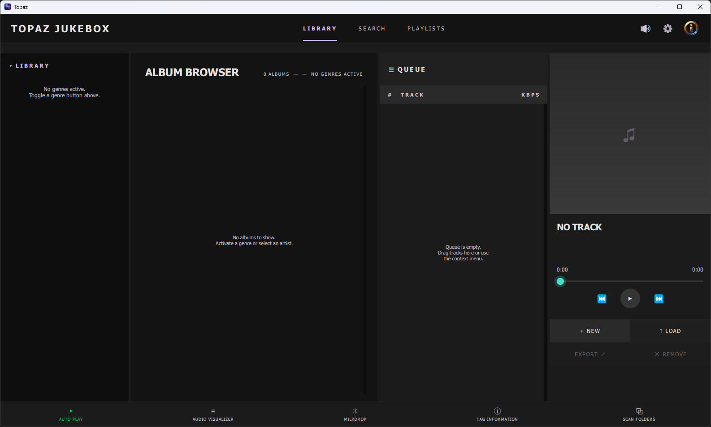

Setting it up takes three steps, all in the **Setup** dialog. Open it with the **gear icon
⚙** in the top-right corner.

### Step 1: add your genres

Topaz organizes music by the **genre tag** of each file. Only genres you add here appear in
Topaz.

1. On the **GENRES** tab, type a genre name — exactly as it appears in your files' genre
   tags, upper/lower case doesn't matter — and press **Enter** or click **ADD**.
2. Repeat for every genre you want.

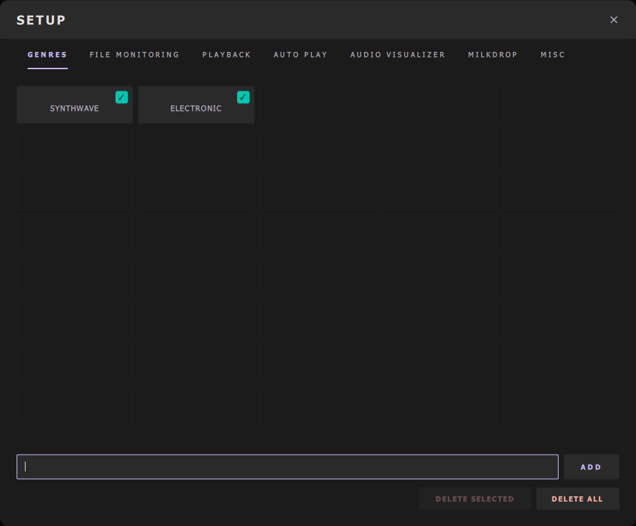

Good to know:

- A file counts for **exactly one** genre. If a tag holds several genres (for example
  `Rock/Pop` or `Rock;Pop`), Topaz uses the **first** one.
- Files whose genre is not in this list are ignored. This is deliberate: you decide which
  parts of a large collection Topaz shows.
- Up to **40** genres can be configured. The checkbox in each cell decides whether that genre
  gets a button in the genre bar of the main window (up to **30** buttons). Unticking it only
  hides the button — the genre's music stays in the library.
- Drag a genre cell to another position to change the order of the genre buttons.
- Select a cell and click **DELETE SELECTED** to remove a genre, or **DELETE ALL** to start over.

### Step 2: add your music folders

1. Switch to the **FILE MONITORING** tab and click **ADD FOLDER**.
2. Choose the folder that holds your music.

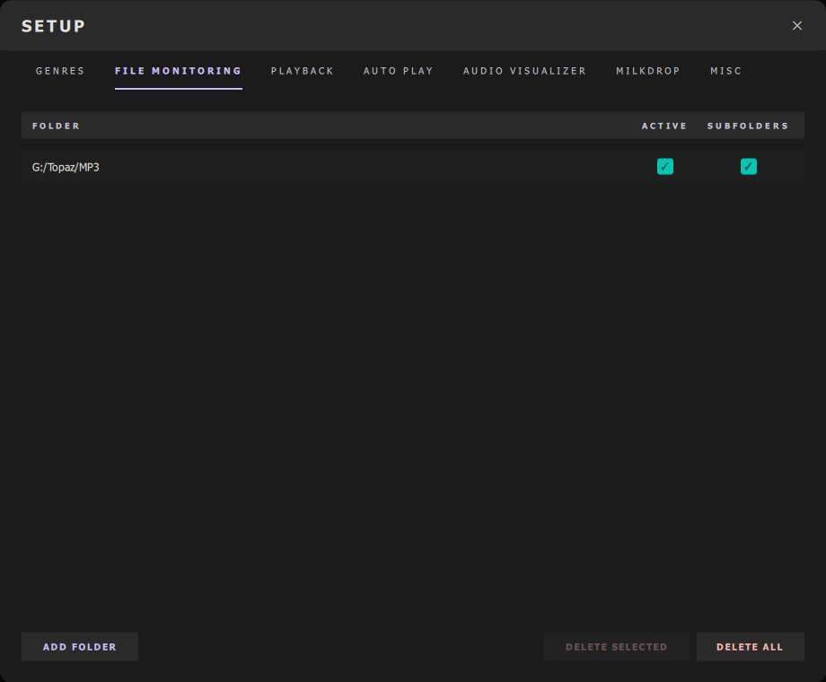

- **ACTIVE** — untick to exclude a folder from scanning without removing it.
- **SUBFOLDERS** — include all subfolders (the usual case).
- If a folder lives on a drive that isn't connected (an external disk, a USB stick), its row
  is dimmed. It comes back by itself when the drive is connected again — even under a
  different drive letter.

### Step 3: scan

Close the Setup dialog with the **✕**. Because the folder list changed, Topaz **scans
automatically**. You can always start a scan yourself with **SCAN FOLDERS** in the
bottom-right corner.

While Topaz is running it also watches your folders: music added or removed there shows up
by itself after a couple of seconds.

**Tip — watch a scan happen:** turn on **Visual Folder Scanning** in Setup → **MISC**. A
SCAN FOLDERS window then appears during every scan, showing the folder being read and a
progress bar, and closes itself when the scan is done. (A small library is scanned so
quickly that the window may only flash briefly.)

Your library is now ready. Click a genre button to see it.

---

## The main window

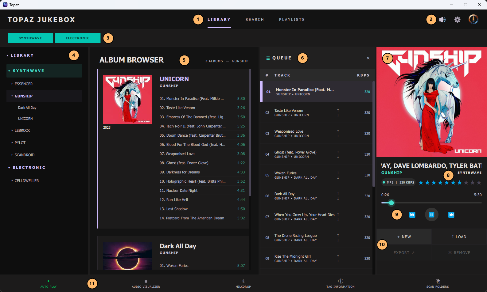

| # | Area | What it is for |
|---|---|---|
| 1 | **LIBRARY · SEARCH · PLAYLISTS** | Switch between browsing, searching and playlists. The left two panels change; the queue and NowPlaying stay. |
| 2 | **Speaker · gear · ⓘ** | System volume and mute · Setup · About Topaz |
| 3 | **Genre bar** | One button per genre. Lit buttons are active. |
| 4 | **Library tree** | Genre → Artist → Album, for narrowing down what the Album Browser shows |
| 5 | **Album Browser** | Album cards with cover, year and all tracks |
| 6 | **Queue** | What plays next |
| 7 | **NowPlaying** | Cover, title, artist and genre of the current track. Click the cover for the Big Cover pane. |
| 8 | **Format · rating** | File format and bitrate (plus the loudness correction, when used) · your rating, 1–10 stars |
| 9 | **Seek bar and transport** | Elapsed/total time, seek, Previous · Play/Pause · Next |
| 10 | **Playlist buttons** | + NEW · LOAD · EXPORT · REMOVE |
| 11 | **Bottom bar** | AUTO PLAY · AUDIO VISUALIZER · MILKDROP · TAG INFORMATION · SCAN FOLDERS |

### Adjusting the layout

- Drag the **dividers** between the panels to make them wider or narrower. The Album Browser
  takes up whatever space is left.
- Every list has a **scrollbar thumb** on its right edge that you can drag with the mouse.
- Topaz remembers the panel widths, the window size and position, and the monitor it was on.

---

## Browsing your library

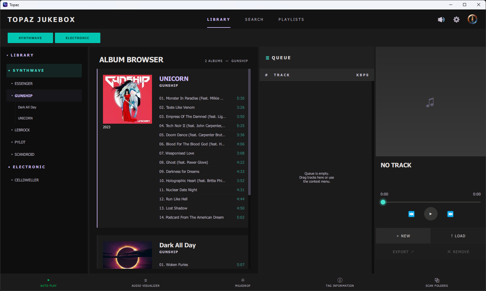

1. **Activate one or more genres** in the genre bar. The library tree lists their artists, and
   the Album Browser shows their albums.
2. **Narrow down** in the library tree:
   - click a **genre** to show only that genre,
   - click an **artist** to show only their albums (the artist expands to list the albums),
   - click an **album** to show just that album.
   Clicking the same entry again goes back one level.
3. Each **album card** shows the cover, the year, and all its tracks with their durations.

The order of the album cards can be chosen in Setup → MISC → **Album Browser & Search Result
Sort Order**: *Artist → Year (newest first) → Album*, or *Artist → Album*.

---

## Searching

Click **SEARCH** in the top bar and type in the search field.

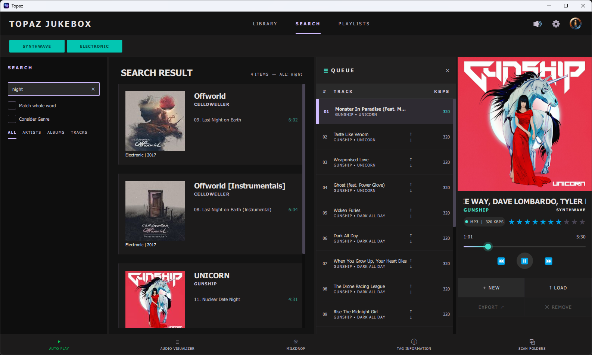

- Results appear as you type, as album cards — and can be added to the queue exactly like in
  the library.
- **ALL · ARTISTS · ALBUMS · TRACKS** choose what is searched. *ARTISTS* and *ALBUMS* show
  the whole artist or album; *TRACKS* shows only the matching tracks.
- **Match whole word** — "night" no longer matches "Nightmare".
- **Consider Genre** — search only the genres that are active in the genre bar. Without it,
  Topaz searches all genres that have a button.

---

## The playback queue

The queue on the right side is the list of tracks Topaz plays, top to bottom.

### Adding tracks

- **Double-click a track** in an album card → it is added to the end of the queue.
- **Drag a track** from an album card onto the queue. The queue lights up when you are over it.
- **Double-click an album's cover** (in the Album Browser) → the **whole album** is added.
- If nothing is playing, the first added track starts playing automatically.

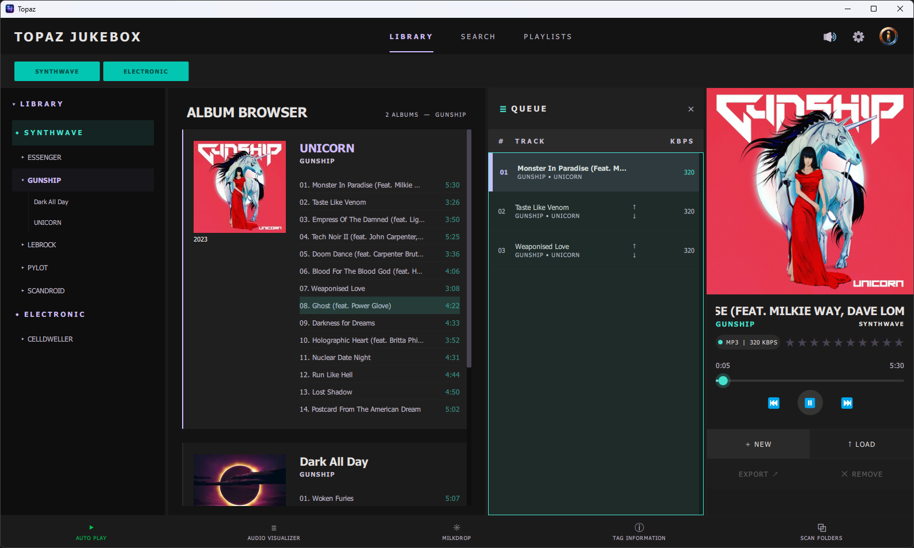

### Working with the queue

| To … | do this |
|---|---|
| play a track from the queue | click its row |
| move a track | use the **↑ / ↓** arrows on the row, or drag its number to a new position |
| remove a track | hover over the row and click its **✕** |
| empty the whole queue | click **✕** in the queue header |

The track playing is highlighted, and the queue scrolls along so that it always stays at the top.

---

## Playback

Use the controls in NowPlaying:

- **Play/Pause** — while you have paused, the button **blinks**.
- **Previous** — restarts the current track; pressed within the first 3 seconds it jumps to the
  previous track.
- **Next** — jumps to the next track.
- **Seek** — click or drag the seek bar.

### Rating tracks

Click one of the **10 stars** to rate the current track. Ratings are stored separately from
the library, so they survive any rescan. AUTO PLAY can use them (see [AUTO PLAY](#auto-play)).

To remove a rating completely, turn on **Delete the Rating for the Track currently playing**
in Setup → MISC. A trash-bin icon then appears left of the stars; it asks for confirmation
before deleting.

### System volume and mute

The **speaker icon** in the top-right corner opens the volume knob. It controls your
computer's **system volume** (not just Topaz).

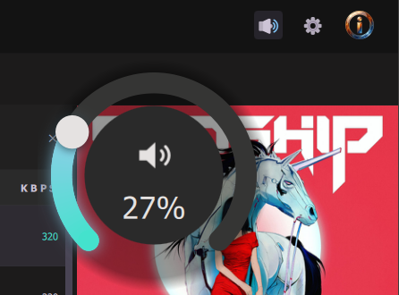

- **Drag** the ring, or turn the **mouse wheel** over the knob (2 % per notch).
- Click the **speaker symbol** in the middle to **mute** or unmute. Muting is the system mute,
  so it stays in sync with your keyboard's mute key.
- The knob closes by itself when the mouse moves away.

---

## Playlists

Playlists are saved as `.xml` files (the open XSPF format) in Topaz's `playlists` folder.
They work across drive letters — a playlist still finds its tracks when your music drive gets
a different letter.

### Saving the queue as a playlist

1. Fill the queue.
2. Click **+ NEW** in NowPlaying, type a name and click **OK**.

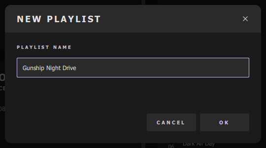

The playlist is now **active**: its name appears in the queue header.

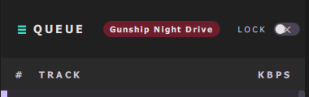

While a playlist is active, **changes to the queue are saved into the playlist file
automatically**. If you want to rearrange or add tracks just for this listening session,
switch on **LOCK** first: locked, the file stays as it is. Unlocking saves the current queue
into the file.

### Loading a playlist

- **LOAD** in NowPlaying opens a file picker in the playlists folder. A playlist from
  somewhere else (another computer, a USB stick) is first **copied into** Topaz's playlists
  folder, then loaded.
- Loading **replaces the queue**. If something is playing and Crossfade is on, the current
  track fades into the playlist's first track.
- **REMOVE** unloads the active playlist and empties the queue. The playlist file itself is
  kept.

### The PLAYLISTS tab

Click **PLAYLISTS** in the top bar to browse all your playlists.

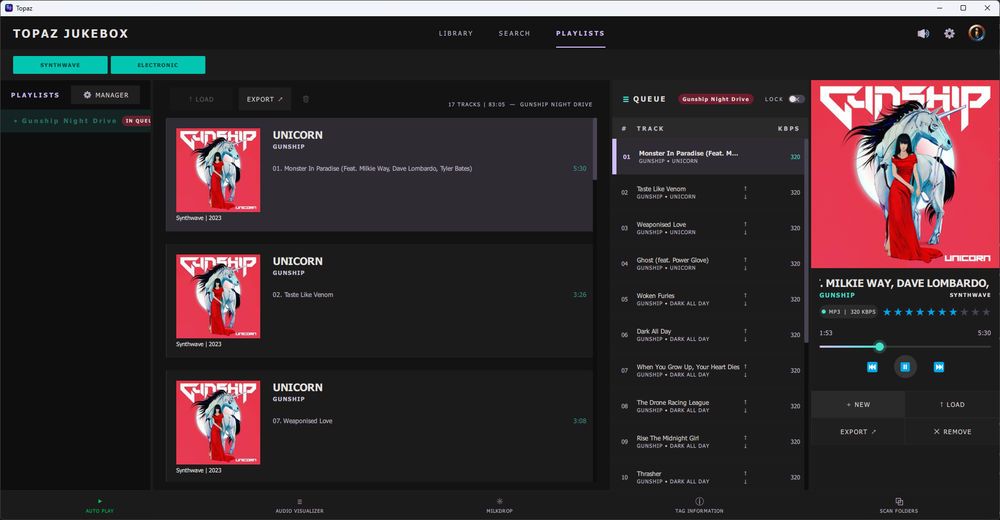

- Click a playlist on the left to **preview** it: one card per track, in playlist order, with
  the number of tracks and total playtime in the header.
- **LOAD** loads the previewed playlist into the queue.
- The playlist that is currently in the queue is marked **IN QUEUE**. When you select it, the
  preview follows the live queue, and the **track playing is highlighted** — just like in the
  queue.
- The **trash-bin icon** deletes the previewed playlist file (after a confirmation). It is not
  available for the playlist currently in the queue.
- Tracks can be added to the queue from the preview just like from the library (double-click
  or drag), except while previewing the playlist that is already in the queue.
- **MANAGER** is reserved for a future version.

### Missing tracks

- When a playlist refers to files that no longer exist, Topaz loads the rest and shows a
  **MISSING TRACKS** list with artist, album, title and the expected location.
- When the file of a queued track has disappeared by the time it is due to play, Topaz
  **stops** cleanly instead of hanging, shows a **MISSING TRACK** message, and rescans just
  that folder so the library is up to date again. A running AUTO PLAY session stops as well.

---

## Exporting a playlist

Export copies all tracks of a playlist to another place — typically a **USB stick for the
car** — with neatly numbered file names.

Start it with **EXPORT** in NowPlaying (exports the playlist in the queue) or **EXPORT** in
the PLAYLISTS tab (exports the previewed playlist).

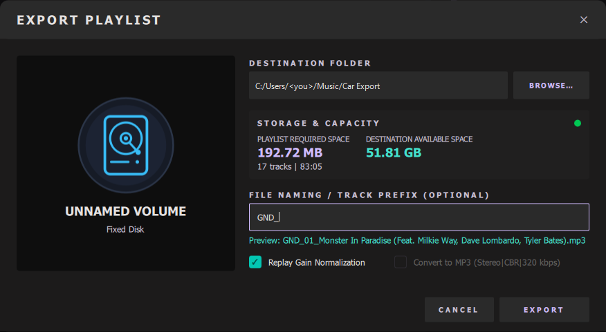

1. **BROWSE…** to choose the destination folder. Topaz checks it right away:
   - the icon shows whether it is a USB stick or a fixed disk,
   - **PLAYLIST REQUIRED SPACE** versus **DESTINATION AVAILABLE SPACE** — the dot turns
     green when everything fits and the destination is writable, red otherwise (with the
     reason).
2. Optional: a **track prefix** for the file names. The preview shows the result, for example
   `GND_01_Monster In Paradise.mp3`. Files are always numbered in playlist order.
3. Optional: **Replay Gain Normalization** — writes a Replay Gain tag into each **copy**, so
   players that support Replay Gain play all tracks at the same loudness. It uses the same
   reference value and Trim as Auto Loudness Correction (Audiophile). Available only when
   BASS is the active playback engine.
4. Optional: **Convert to MP3 (Stereo|CBR|320 kbps)** — every FLAC or Opus track is converted
   to an MP3 (44.1 kHz, stereo, constant 320 kbps) while it is copied; MP3 tracks are copied
   as they are. Tags and cover art are carried over. This needs **ffmpeg** (see
   [Optional extras](#optional-extras-you-can-add-yourself)). The checkbox is dimmed when the
   playlist contains no FLAC/Opus tracks or ffmpeg isn't found — its tooltip says which.
   With it ticked, the required space is recalculated for the MP3 sizes.
5. Click **EXPORT**.

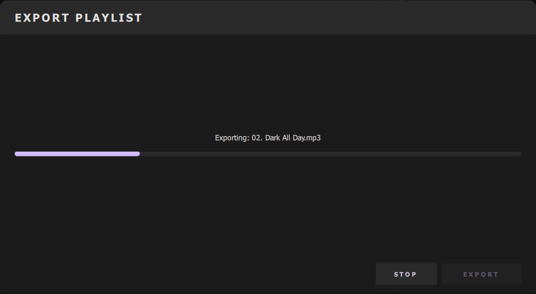

The progress bar shows how far the export is; **STOP** cancels it. At the end Topaz reports
how many tracks were copied — and, if any were converted, how many were converted to MP3.
Any track that failed is listed.

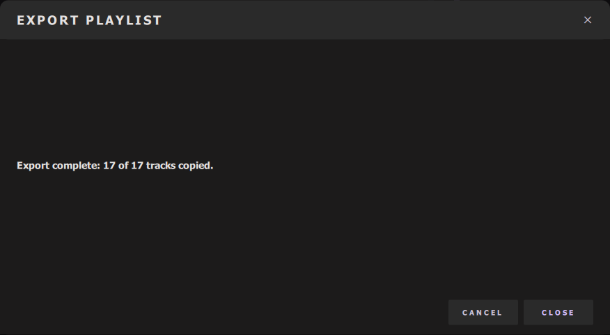

**Your original files are never touched** — Replay Gain tags and MP3 conversion only ever
apply to the exported copies.

---

## AUTO PLAY

AUTO PLAY turns Topaz into a real jukebox: it keeps adding randomly chosen tracks from your
library, so the music never stops.

- Click **AUTO PLAY** in the bottom bar to start it. The button turns **red** while it runs;
  click it again to stop.
- If the queue is empty, the first track starts immediately. Otherwise AUTO PLAY waits and
  then tops up the queue one track at a time.
- When no suitable track is left (for example every track has been played once), AUTO PLAY
  stops by itself. On Windows you get a desktop notification when AUTO PLAY starts, stops or
  runs out of tracks.

During a session the queue belongs to AUTO PLAY: it can't be cleared, LOAD and REMOVE are
disabled, and — unless you allow it — tracks can't be added, removed or moved by hand.

### AUTO PLAY settings

These are on the **AUTO PLAY** tab of the Setup dialog.

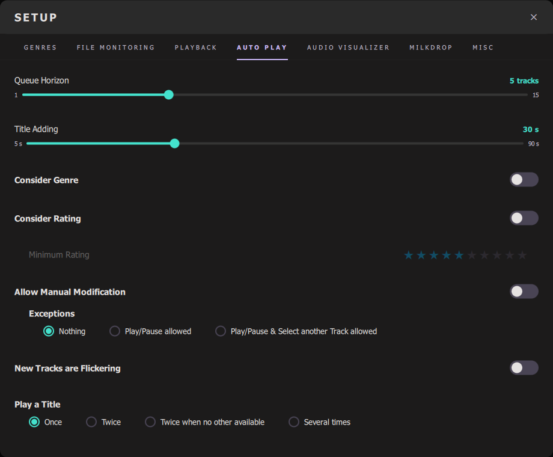

| Setting | Meaning |
|---|---|
| **Queue Horizon** (1–15 tracks) | How many tracks AUTO PLAY keeps queued ahead of the one playing |
| **Title Adding** (5–90 s) | How often AUTO PLAY checks the queue and adds a track if needed |
| **Consider Genre** | Only pick tracks from the genres active in the genre bar |
| **Consider Rating** + **Minimum Rating** | Only pick tracks rated at least this many stars (unrated tracks are skipped) |
| **Allow Manual Modification** | Lets you add, remove and move tracks during a session |
| **Exceptions** | Without manual modification: *Nothing* · *Play/Pause allowed* · *Play/Pause & Select another Track allowed* |
| **New Tracks are Flickering** | Newly added tracks briefly flash in the queue |
| **Play a Title** | *Once* · *Twice* · *Twice when no other available* · *Several times* — how often a track may be picked in one session |

The AUTO PLAY button can only be started when its requirements can be met — for example with
Consider Genre on, at least one genre must be active.

---

## Sound settings

All of these are on the **PLAYBACK** tab of the Setup dialog.

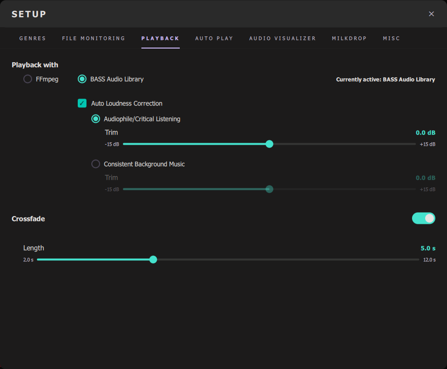

### Playback engine

| Engine | |
|---|---|
| **FFmpeg** | Built in, needs nothing. The default. |
| **BASS Audio Library** | Needs the BASS files (see [Optional extras](#optional-extras-you-can-add-yourself)). Required for Auto Loudness Correction and Replay Gain export. |

Switching the engine takes effect **after restarting Topaz**; Topaz reminds you. "Currently
active" shows the engine that is really running.

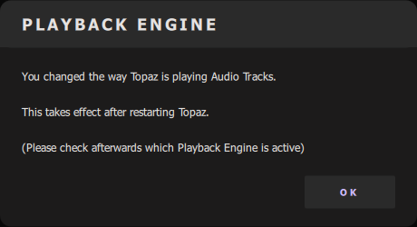

### Crossfade

Turn on **Crossfade** and choose the **Length** (2–12 seconds): the next track fades in while
the current one fades out. It also applies when you load a different playlist while music is
playing. Tracks that are too short for the chosen length simply switch without a fade.

### Auto Loudness Correction (BASS only)

Tracks are mastered at very different loudness. Auto Loudness Correction evens this out —
**without ever changing a file**.

- **Audiophile/Critical Listening** — one fixed correction per track, based on its measured
  loudness (or an existing Replay Gain tag). The dynamics stay untouched. The correction is
  measured once and remembered; NowPlaying shows the value applied, for example `-10.9 dB`.
- **Consistent Background Music** — a gentle compressor that keeps everything at a similar
  level, for background listening. Needs BASS_FX.
- **Trim** (each strategy has its own, −15 to +15 dB in 0.1 dB steps) — your own adjustment on
  top. The automatic Audiophile level is fairly quiet by design (it follows the Replay Gain
  standard); raise Trim if you want it louder. Unlike the automatic correction, a large
  positive Trim can clip on very loud peaks.

### Hi-Res badge

If you place an image named `Hi-Res_Audio.svg` next to `Topaz.exe`, Topaz shows it in the top
bar while a FLAC track is playing. The logo is a trademark and therefore not included.

---

## Detachable panes and full screen

Four extra windows ("panes") can float anywhere — on the same screen or a second monitor —
for example as a "now playing" display at a party.

| Pane | Opens with | |
|---|---|---|
| **Big Cover** | a click on the cover in NowPlaying |  |
| **Tag Information** | **TAG INFORMATION** in the bottom bar | 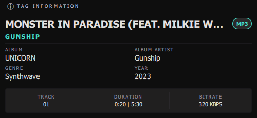 |
| **Audio Visualizer** | **AUDIO VISUALIZER** in the bottom bar | 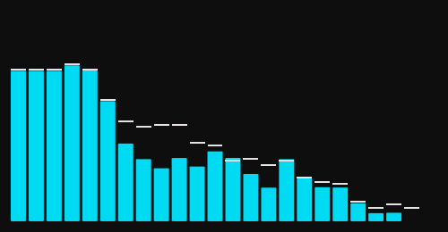 |
| **Milkdrop** | **MILKDROP** in the bottom bar |  |

Working with panes:

- **Move** a pane by dragging it anywhere; **resize** it at its edges (the Big Cover keeps
  its square shape).
- **Right-click** a pane to close it (or click its button in the bottom bar again).
- **Double-click** the Big Cover or Milkdrop pane to move it across its screen: centered → right
  edge → left edge → back where it was.
- **Double-click** the Tag Information pane to stretch it across the full width of its screen,
  and again to restore it. Its text grows and shrinks with the pane. Its **DURATION** field shows
  the **time remaining** and the total length (for example `0:20 | 5:30`).
- **F10** switches the Milkdrop pane to full screen on the monitor it is on, and back.
- Topaz remembers where each pane was, including on which monitor.

The **Audio Visualizer** (bars) and **Milkdrop** are configured on their own Setup tabs — see
the [Setup reference](#setup-reference). Milkdrop needs **preset files** (`.milk`, freely
available on the internet); add the folder holding them on the MILKDROP tab. Milkdrop also
needs a graphics driver with OpenGL 3.3 or newer.

### Full screen

- **F11** switches the main window between full screen and a normal window.
- **Start Topaz in Full Screen** (Setup → MISC) starts Topaz that way, on the monitor it was
  last on.
- In full screen the **mouse pointer hides** after 5 seconds without movement and comes back
  as soon as you move the mouse.
- **Kiosk mode:** while the main window is full screen, open panes stay **on top**, even over
  the taskbar — ideal for a dedicated jukebox display.
- Windows hides desktop notifications (such as AUTO PLAY's) while an app is in full screen.
  This is Windows' Focus Assist, which you can change in the Windows settings.

---

## Setup reference

Every option of the Setup dialog in one place. All changes are saved immediately.

### GENRES

See [Step 1: add your genres](#step-1-add-your-genres).

### FILE MONITORING

See [Step 2: add your music folders](#step-2-add-your-music-folders).

### PLAYBACK

See [Sound settings](#sound-settings).

### AUTO PLAY

See [AUTO PLAY settings](#auto-play-settings).

### AUDIO VISUALIZER

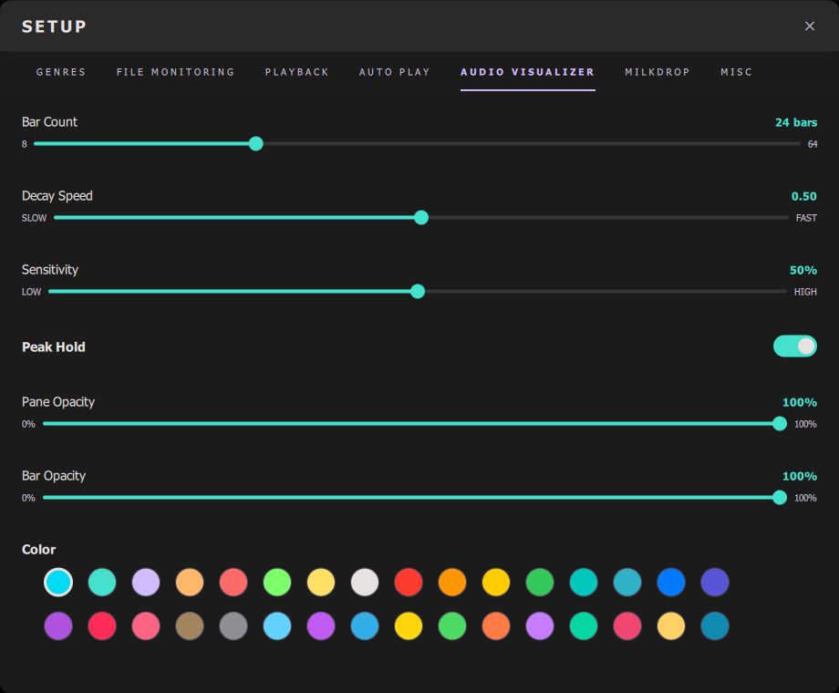

| Setting | Meaning |
|---|---|
| **Bar Count** | Number of bars (8–64) |
| **Decay Speed** | How fast the bars fall back |
| **Sensitivity** | How strongly the bars react |
| **Peak Hold** | Small markers that show each bar's recent peak |
| **Pane Opacity** · **Bar Opacity** | Transparency of the pane background and of the bars — at low pane opacity the bars float over your desktop |
| **Color** | Color of the bars |

### MILKDROP

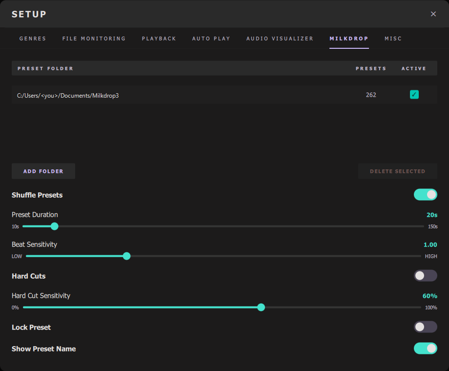

| Setting | Meaning |
|---|---|
| **Preset folders** | Folders with `.milk` preset files; **ADD FOLDER** / **DELETE SELECTED**, **ACTIVE** per folder. **PRESETS** shows how many were found. |
| **Shuffle Presets** | Random preset order instead of a fixed one |
| **Preset Duration** | How long each preset is shown (10–150 s) |
| **Beat Sensitivity** | How strongly the visuals react to the beat |
| **Hard Cuts** · **Hard Cut Sensitivity** | Allow abrupt preset changes on strong beats, and how easily they happen |
| **Lock Preset** | Stay on the current preset |
| **Show Preset Name** | Briefly fade in the preset's name at the bottom when it changes |

### MISC

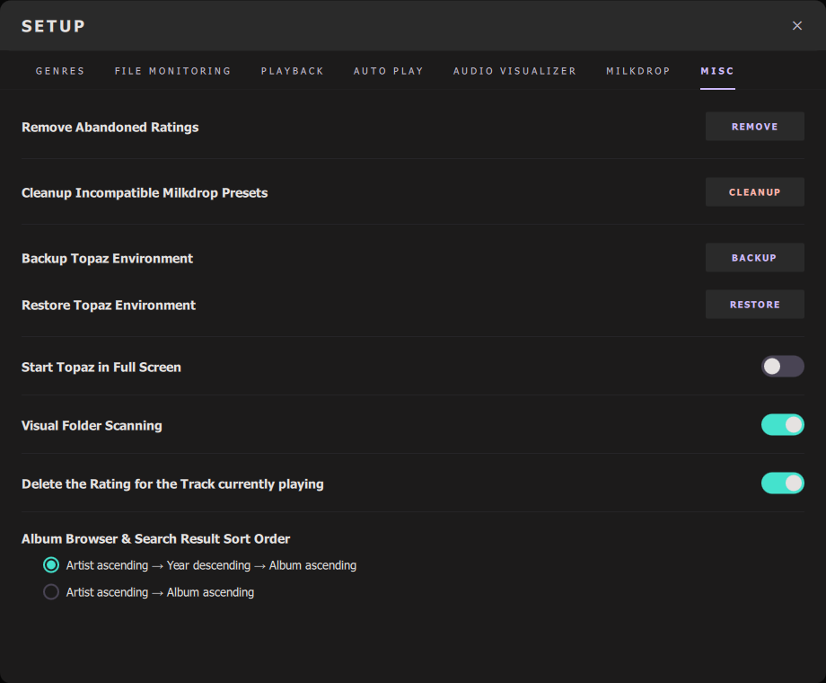

| Setting | Meaning |
|---|---|
| **Remove Abandoned Ratings** | Deletes ratings of tracks that are no longer in your library |
| **Cleanup Incompatible Milkdrop Presets** | Finds and deletes preset files that don't work in Topaz |
| **Backup Topaz Environment** · **Restore Topaz Environment** | See [Maintenance and backup](#maintenance-and-backup) |
| **Start Topaz in Full Screen** | Takes effect on the next start |
| **Visual Folder Scanning** | Shows the SCAN FOLDERS progress window during scans |
| **Delete the Rating for the Track currently playing** | Shows a trash-bin icon next to the rating stars |
| **Album Browser & Search Result Sort Order** | *Artist → Year (newest first) → Album*, or *Artist → Album* |

---

## Maintenance and backup

### Backup

Setup → MISC → **BACKUP** saves your Topaz environment into a single `.zip` file.

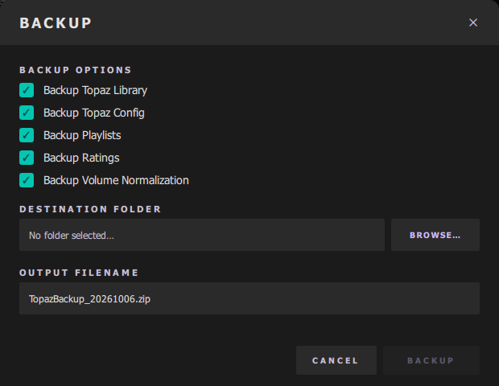

Choose what to include — **Library**, **Config**, **Playlists**, **Ratings**, **Volume
Normalization** — a destination folder and a file name (it defaults to today's date), then
click **BACKUP**.

### Restore

Setup → MISC → **RESTORE** brings a backup back.

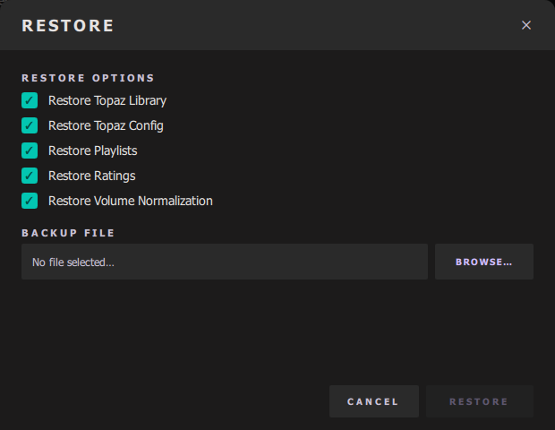

Choose the backup file and which parts to restore, then click **RESTORE**. Topaz asks for
confirmation first, because restoring **replaces** the current data of the chosen parts. The
restored data is active immediately — no restart needed.

Backups are also a quick way to switch between completely different setups, for example one
for your FLAC collection and one for an MP3 collection.

### Other housekeeping

- **Remove Abandoned Ratings** — tidies up ratings of tracks you no longer have.
- **Cleanup Incompatible Milkdrop Presets** — removes preset files that Topaz can't display.
- **SCAN FOLDERS** — a full rescan of all active music folders.

### About Topaz

The **ⓘ** icon in the top-right corner shows the version, the build date and some statistics
about your library.

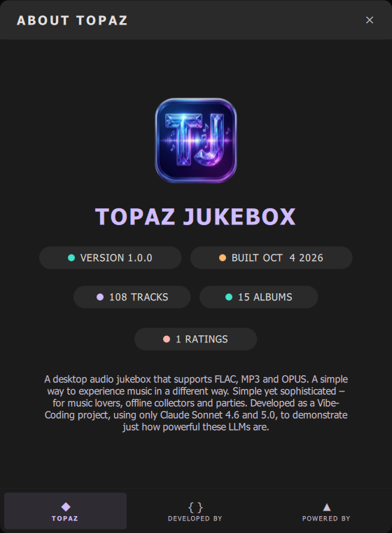

---

## Troubleshooting

**The library stays empty.**
Check, in this order: the genre buttons are **active** (lit) · the genre is configured in Setup →
GENRES, spelled like the files' genre tags · the music folder is in FILE MONITORING with
**ACTIVE** ticked · then click **SCAN FOLDERS**.

**Some tracks are missing.**
Their genre tag probably doesn't match a configured genre. Remember that Topaz uses only the
**first** genre of a multi-genre tag.

**"BASS Audio Library" can't be used.**
The BASS files are missing next to `Topaz.exe` / `topaz-bin`, or Topaz hasn't been restarted
after switching the engine.

**Auto Loudness Correction or Replay Gain Normalization is greyed out.**
Both need BASS as the **running** engine.

**"Convert to MP3" is greyed out.**
Hover over it: either the playlist has no FLAC/Opus tracks, or no ffmpeg with the LAME encoder
was found (next to `Topaz.exe` or on the PATH).

**Milkdrop shows nothing.**
Add a preset folder on the MILKDROP tab. If it says MILKDROP UNAVAILABLE, your graphics driver
doesn't offer OpenGL 3.3.

**No AUTO PLAY notifications.**
They don't appear while Topaz is in full screen (Windows Focus Assist).

**Linux: Topaz doesn't start.**
Start it with `./run-topaz.sh`, not `topaz-bin`. See `README-Linux.txt` for details.

**I want to start over.**
Make a backup first. Then close Topaz and delete (or rename) its data folder — see
[Where Topaz keeps its data](#where-topaz-keeps-its-data). Topaz starts like on the very first
day.

---

## Mouse and keyboard reference

### Keyboard

| Key | Action |
|---|---|
| **F11** | Main window: full screen on/off |
| **F10** | Milkdrop pane: full screen on/off |
| **Enter** | Setup → GENRES: add the typed genre · New Playlist: OK |
| **Esc** | New Playlist: cancel |

### Mouse

| Where | Action | Result |
|---|---|---|
| Album card — track | double-click | add the track to the queue |
| Album card — track | drag onto the queue | add the track to the queue |
| Album Browser — cover | double-click | add the whole album to the queue |
| Queue — row | click | play that track |
| Queue — row | ↑ / ↓ / ✕ | move up / move down / remove |
| Queue — track number | drag | move the track to another position |
| Queue header — ✕ | click | empty the queue |
| NowPlaying — cover | click | open the Big Cover pane |
| NowPlaying — stars | click | rate the track (1–10) |
| Volume knob | drag / mouse wheel / click the speaker | set the system volume / mute |
| Any pane | drag / drag the edges | move / resize |
| Any pane | right-click | close the pane |
| Big Cover / Milkdrop pane | double-click | move across the screen |
| Tag Information pane | double-click | full width on/off |
| Panel dividers | drag | resize the panels |
| Scrollbar thumbs | drag | scroll |
